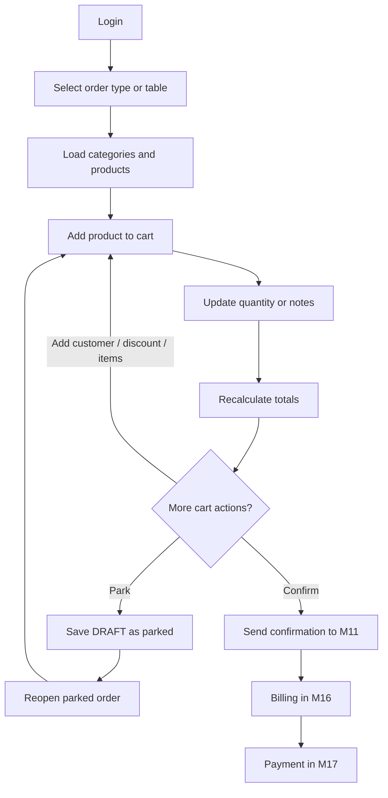

# M10 — POS and Cart Management
**System:** DineMaster  
**Module:** M10  
**Classification:** EDGE, OPS  
**Primary users:** Cashier, Manager  
**Document type:** Module-level technical specification

---

## 1. Purpose

M10 provides the fast billing terminal used by Cashiers and Managers to create and manage a customer's cart before the order is confirmed. It supports multiple order types, product/category navigation, quantity and item notes, customer attachment, discounts, GST totals, and parking/reopening a cart.

The cart is persisted as a `DRAFT` order on the Edge so that it survives application or device crashes. M10 uses the shared totals calculator defined in Chapter 7.6. Order confirmation belongs to M11; billing and payment are handled by M16 and M17.

## 2. Scope and ownership

### 2.1 In scope

- POS main screen with category rail, product grid and cart panel.
- Order type selection:
  - Dine-In
  - Table
  - Takeaway
  - Delivery
  - Online
  - Walk-in
- Add products to cart.
- Change item quantity.
- Add or update item notes.
- Search products and navigate categories.
- Attach a customer to the order.
- Apply flat or percentage discounts with a remark.
- Calculate subtotal, discount, GST/tax, round-off and total through the shared calculator.
- Park a draft order and reopen it without losing its cart.
- Fully functional offline POS operation on the Edge.

### 2.2 Out of scope / delegated ownership

| Capability | Owning module |
|---|---|
| Order confirmation and lifecycle transitions | M11 — Order Management |
| Kitchen ticket generation | M13 — Kitchen Order Ticket |
| Billing / invoice generation | M16 |
| Payment collection and settlement | M17 |
| Menu and product master data | M7 / M8 |
| Customer master data | Customer module |

M10 may display and select data from these modules, but should not duplicate their master-data or lifecycle responsibilities.

## 3. Roles and permissions

| Role | Source-defined responsibility |
|---|---|
| Cashier | Operates the fast billing terminal |
| Manager | Operates the terminal and approves discounts above the configured limit using Manager PIN |

**Source-defined control:** Discount limits are role-based. A discount above the permitted limit requires Manager PIN approval. A discount remark is mandatory and the action must be audited.

**[PROPOSED DETAIL]** Enforce permissions and approval on the Edge/API service, not only by hiding UI controls. Record the acting cashier, approving manager, discount type, value, remark and timestamp in the audit trail. Exact permission keys and approval thresholds are not specified in the master document and must be configured/approved separately.

## 4. User journey

1. User logs in.
2. User selects an order type or selects a table where applicable.
3. POS loads the relevant menu categories and products.
4. User adds products to the cart.
5. User adjusts quantities and adds item notes.
6. User optionally attaches a customer.
7. User optionally applies a flat or percentage discount and supplies a remark.
8. M10 recalculates totals after each cart change using the shared calculator.
9. User may park the draft order and reopen it later. The cart must remain intact.
10. When ready, the user confirms the order through M11.
11. Billing and payment take place later through M16 and M17.



## 5. Screens and UI responsibilities

### 5.1 POS Main

Main billing workspace. It contains:

- **Category rail:** category navigation.
- **Product grid:** products available for selection.
- **Cart panel:** selected items, quantities, notes and totals.
- **Order type/table context:** selected service mode and table where applicable.
- **Customer entry point:** opens Customer Picker.
- **Discount entry point:** opens Discount Dialog.
- **Park action:** saves the draft cart for later reopening.
- **Confirm action:** hands the order to M11.

**[PROPOSED DETAIL]** Show clear loading, empty-menu, unavailable-product and cart-error states. Disable confirmation while a cart mutation is being submitted to avoid accidental duplicate actions; the server must still enforce idempotency where applicable.

### 5.2 Customer Picker

Allows the cashier to search/select a customer and attach that customer to the draft order.

The master document confirms customer attachment and that M10 reads Customer data. Search fields, customer creation from this dialog, and the exact customer matching rules are not specified.

### 5.3 Discount Dialog

Supports:

- Flat discount.
- Percentage discount.
- Mandatory remark.
- Manager PIN approval when the discount exceeds the configured role limit.

The shared calculator determines the final discount and tax allocation. The UI must display the recalculated totals before the user proceeds.

### 5.4 Parked Orders

Lists draft orders that have been parked so the cashier can reopen them. Reopening must restore the cart rather than create a new empty cart.

**[PROPOSED DETAIL]** Display order number, order type, table (if any), creation/last-update time, customer (if attached) and amount to help staff identify the correct parked order. These display fields are recommendations; the source does not define the exact list columns.

## 6. Cart domain rules

### 6.1 Draft persistence

- The cart is stored as an order with `status = DRAFT`.
- The draft lives on the Edge.
- Draft persistence is required so that the cart survives crashes.
- `CartService` uses the shared calculator.
- Parked orders retain their cart.

### 6.2 Add-item merge rule

When adding a product:

- If an existing cart line has the same product **and the same notes**, increment that line's quantity.
- Otherwise, create a new cart line.
- Recalculate totals after each change.

This means notes participate in cart-line identity. Two lines for the same product but with different notes must remain separate.

### 6.3 Quantity and notes

- Quantity changes are reflected in the cart.
- Item notes can be set or changed.
- Every cart mutation triggers a totals recalculation.
- The database schema defines `quantity` as a positive numeric value.

**[PROPOSED DETAIL]** Validate quantity as greater than zero in both UI and service layer. The master source does not define whether fractional quantities are allowed in POS; confirm this with the product owner before restricting quantity to integers.

### 6.4 Product snapshot

The `ops.order_items` schema stores `product_name`, `unit_price` and `tax_rate_percent` at order time. Product name and price are snapshots, so later menu edits must not silently rewrite historical order lines.

At confirmation, Chapter 7.5 requires revalidation of product active/availability and price against the stored snapshot. The exact user-facing handling when a price has changed is not defined in M10 and should be agreed with M11.

### 6.5 Cart capacity

The module's test requirements include a **100-line cart**. Treat 100 lines as the test/load boundary specified by the source; the source does not explicitly state whether 100 is a hard maximum or merely a test size.

## 7. Totals calculation

M10 must not implement its own independent pricing formula. It must call the shared calculator in Chapter 7.6 so Edge and Cloud produce consistent totals.

### 7.1 Source-defined calculation

```text
for each item (not CANCELLED):
   line = unit_price * qty
subtotal = sum(line)
discount = flat or percent of subtotal (percent rounded half-up to 2 decimals)
taxable_i = line_i - discount * (line_i / subtotal)       # discount spread by share
tax_i = taxable_i * rate_i / 100                          # per slab, rounded half-up
total_raw = subtotal - discount + sum(tax_i)
round_off = round(total_raw) - total_raw                  # to nearest rupee [ASSUMPTION]
total = total_raw + round_off
```

### 7.2 Calculation requirements

- Exclude `CANCELLED` items from totals.
- Calculate each line as unit price multiplied by quantity.
- Support flat and percentage discounts.
- Percentage discount is rounded half-up to two decimal places.
- Spread the discount across taxable lines proportionally by line value.
- Calculate tax per slab and round half-up.
- Calculate round-off to the nearest rupee as an explicit **[ASSUMPTION]** in the master document.
- Recalculate after each cart change.
- Use the same calculator implementation/test vectors on Edge and Cloud.

### 7.3 GST and tax review

The master document requires CGST and SGST to be split equally and GSTIN printing for legal Indian invoices. It also explicitly states that exact rules need tax review (**Pending P6**).

Do not treat the current formula as final legal tax advice. Tax-inclusive/exclusive pricing, intra-state/inter-state behavior, cess, exemptions, invoice place-of-supply rules and GST rounding policy require confirmation by the tax/accounting owner.

### 7.4 Discount restrictions

- Discount limits are based on role.
- Discount above the configured limit requires Manager PIN.
- Remark is mandatory.
- Discount action is audited.
- The test plan explicitly includes the 100-percent discount edge; 100% discount is blocked.

**[PROPOSED DETAIL]** Reject negative discounts, malformed percentages and discounts that exceed the eligible subtotal. The source explicitly confirms that 100% is blocked but does not state the exact validation response or whether the maximum permitted value is configurable.

## 8. Events and application state

### 8.1 Events

| Event | Meaning |
|---|---|
| `ItemAdded` | Product added to the cart |
| `QtyChanged` | Cart-line quantity changed |
| `NoteSet` | Item note set or updated |
| `DiscountApplied` | Discount applied to the draft |
| `OrderParked` | Draft order parked |
| `OrderConfirmed` | Order confirmation completed through the M11 flow |

### 8.2 States

| State | Meaning |
|---|---|
| `CartState(items, totals)` | Current cart lines and calculated totals |
| `CartSubmitting` | Cart mutation or submission in progress |
| `CartError` | Cart operation failed |

**[PROPOSED DETAIL]** Keep the cart state derived from the persisted draft where possible. After a write succeeds, refresh or reconcile the local state from the service response. Do not optimistically discard a cart line if the Edge write fails.

## 9. Backend and service design

### 9.1 Source-defined service

- `CartService` — manages the cart and delegates calculations to the shared calculator.

### 9.2 Suggested responsibility split

The following decomposition is **[PROPOSED DETAIL]**, not a set of source-mandated class names:

| Component | Responsibility |
|---|---|
| `CartService` | Add/update/remove cart lines, attach customer, park/reopen draft |
| Shared `TotalsCalculator` | Calculate subtotal, discount, tax, round-off and total |
| `DiscountPolicy` | Validate role limit and Manager PIN approval |
| `OrderRepository` | Persist/read `ops.orders` and `order_items` |
| `MenuReadService` | Read categories and products from menu domain |
| `CustomerReadService` | Search/read customer records |
| Audit service | Persist discount approval and audit events |

The calculator should be a shared domain package/library, not duplicated separately in Flutter and backend implementations.

## 10. API contract

M10 refers to the M11 order endpoints for its cart operations. The source lists these paths without a complete request/response schema:

| Method | Endpoint | Purpose |
|---|---|---|
| `POST` | `/api/v1/orders` | Create a draft order |
| `PUT` | `/api/v1/orders/{id}/items` | Update order items |
| `POST` | `/api/v1/orders/{id}/discount` | Apply discount |
| `POST` | `/api/v1/orders/{id}/park` | Park draft order |

The M10 source says “See Module 11 endpoints” and gives abbreviated paths without the `/api/v1` prefix. The full M11 endpoint convention is used above for consistency with the master API table. Confirm the final route definitions in the OpenAPI contract before implementation.

### 10.1 API behavior requirements

- Create the cart as a `DRAFT` order.
- Persist item changes to the Edge.
- Recalculate totals after item changes and discount changes.
- Persist `parked = true` when parking.
- Reopen the existing draft with its cart intact.
- Do not confirm the order through a separate M10 lifecycle implementation; use M11.

**[PROPOSED DETAIL]** Use optimistic version checks (`version`) when updating a draft from multiple terminals. The schema contains a version field, but the exact conflict response and concurrency policy must be defined with M11.

## 11. Data model

### 11.1 Tables used

M10 uses:

- `ops.orders`
- `ops.order_items`

The schema is defined in Chapter 6.6.

### 11.2 Relevant `ops.orders` columns

| Column | Purpose |
|---|---|
| `id` | Order UUID |
| `tenant_id` | Tenant scope |
| `branch_id` | Branch scope |
| `order_no` | Branch-unique order number |
| `order_type` | Order service type |
| `channel` | Source channel; POS is default |
| `table_id` | Optional table reference |
| `customer_id` | Optional customer reference |
| `waiter_id` | Optional waiter reference |
| `guest_count` | Guest count |
| `status` | Draft/order lifecycle status |
| `subtotal` | Calculated subtotal |
| `discount_amount` | Discount amount |
| `discount_remark` | Mandatory discount remark when discount is applied |
| `tax_amount` | Calculated tax |
| `round_off` | Rounding adjustment |
| `total` | Final calculated total |
| `notes` | Order-level notes |
| `parked` | Whether the draft is parked |
| `idempotency_key` | Duplicate-request protection |
| `origin_device_id` | Originating device |
| `created_by` | User who created the order |
| `version` | Record version |
| `deleted_at` | Soft-delete timestamp |

The source schema defines `order_type` values as `DINE_IN`, `TAKEAWAY`, `DELIVERY`, `ONLINE`, and `WALK_IN`. The M10 feature description additionally names “Table” as a selectable POS order type. This is a terminology/schema alignment point: confirm whether Table is represented by `DINE_IN` plus `table_id`, rather than adding a separate enum value.

### 11.3 Relevant `ops.order_items` columns

| Column | Purpose |
|---|---|
| `id` | Order-line UUID |
| `tenant_id` | Tenant scope |
| `order_id` | Parent order |
| `product_id` | Soft reference to `core.products` |
| `product_name` | Product-name snapshot |
| `unit_price` | Unit-price snapshot |
| `tax_rate_percent` | Tax-rate snapshot |
| `quantity` | Positive quantity |
| `line_total` | Calculated line total |
| `spice_level` | Optional item preference |
| `diet_pref` | Optional dietary preference |
| `notes` | Item notes |
| `status` | Item lifecycle state |
| `station` | Kitchen station routing |

### 11.4 Schema excerpt

The following excerpt is adapted from the master schema for the columns directly relevant to M10. It is not a replacement for the full Chapter 6.6 migration.

```sql
CREATE TABLE ops.orders (
  id uuid PRIMARY KEY,
  tenant_id uuid NOT NULL,
  branch_id uuid NOT NULL,
  order_no varchar(30) NOT NULL,
  order_type varchar(15) NOT NULL CHECK (
    order_type IN ('DINE_IN','TAKEAWAY','DELIVERY','ONLINE','WALK_IN')
  ),
  channel varchar(15) NOT NULL DEFAULT 'POS' CHECK (
    channel IN ('POS','WAITER','QR','ONLINE')
  ),
  table_id uuid,
  customer_id uuid,
  waiter_id uuid,
  guest_count smallint,
  status varchar(15) NOT NULL DEFAULT 'DRAFT' CHECK (
    status IN ('DRAFT','CONFIRMED','BILLED','PAID','COMPLETED','CANCELLED','VOIDED')
  ),
  subtotal numeric(12,2) NOT NULL DEFAULT 0,
  discount_amount numeric(12,2) NOT NULL DEFAULT 0,
  discount_remark text,
  tax_amount numeric(12,2) NOT NULL DEFAULT 0,
  round_off numeric(5,2) NOT NULL DEFAULT 0,
  total numeric(12,2) NOT NULL DEFAULT 0,
  notes text,
  parked boolean NOT NULL DEFAULT false,
  idempotency_key varchar(64),
  origin_device_id uuid,
  created_by uuid NOT NULL,
  version integer NOT NULL DEFAULT 1,
  deleted_at timestamptz,
  UNIQUE (branch_id, order_no)
);

CREATE TABLE ops.order_items (
  id uuid PRIMARY KEY,
  tenant_id uuid NOT NULL,
  order_id uuid NOT NULL REFERENCES ops.orders(id),
  product_id uuid NOT NULL,
  product_name varchar(150) NOT NULL,
  unit_price numeric(12,2) NOT NULL,
  tax_rate_percent numeric(5,2) NOT NULL,
  quantity numeric(8,2) NOT NULL CHECK (quantity > 0),
  line_total numeric(12,2) NOT NULL,
  spice_level varchar(15),
  diet_pref varchar(20),
  notes text,
  status varchar(12) NOT NULL DEFAULT 'NEW' CHECK (
    status IN ('NEW','PENDING','COOKING','READY','SERVED','CANCELLED')
  ),
  cancel_reason text,
  station varchar(30),
  version integer NOT NULL DEFAULT 1
);
```

## 12. Offline and Edge behavior

M10 is explicitly marked **fully functional offline**.

- The Edge stores the draft order and its item lines locally.
- A cart survives an application/device crash because it is persisted rather than held only in widget memory.
- Cart changes and totals calculation must work without Cloud connectivity.
- The shared calculator must produce consistent results on Edge and Cloud.
- Synchronisation of Edge data is handled by the platform's offline synchronisation module, not by a separate M10 sync implementation.

**[PROPOSED DETAIL]** If Cloud connectivity is unavailable, do not block adding items, changing quantity, applying an allowed discount, or parking/reopening a draft. Show sync state separately from the local cart state. The precise offline discount-approval fallback (for example, locally cached Manager PIN credentials) is not defined and needs a security decision.

## 13. Integration and dependencies

| Dependency | M10 usage |
|---|---|
| M1 Authentication & Authorization | User identity and role context |
| M7 Menu & Category Management | Category navigation and product data |
| M8 Product Management | Product price, tax slab, availability and product metadata |
| Customer module | Customer lookup and attachment |
| Shared calculator, Chapter 7.6 | Single source of truth for totals |
| M11 Order Management | Draft/order APIs and confirmation lifecycle |
| M16 Billing | Subsequent bill/invoice flow |
| M17 Payment | Subsequent payment flow |
| M28 Offline Data Synchronisation | Edge-to-Cloud synchronisation |

M10 reads Menu and Customer data and writes Order data.

## 14. Validation and error handling

### 14.1 Source-defined validations

- Discount remark is mandatory.
- Discount above role limit requires Manager PIN.
- 100% discount is blocked.
- Cart line quantity must satisfy the database positive-quantity constraint.
- Totals are recalculated after every cart change.
- A parked order retains its cart.
- The cart test scope includes 100 lines.

### 14.2 Recommended service validations

The following are **[PROPOSED DETAIL]**:

- Reject cart mutation if the order is not `DRAFT`.
- Reject products that are inactive or unavailable when the order is confirmed, following M11 confirmation validation.
- Verify the order belongs to the active tenant and branch.
- Verify discount amount is not negative and does not exceed the eligible subtotal.
- Validate Manager PIN server-side and record the approving identity.
- Return a structured conflict response if the draft version is stale.
- Preserve the persisted draft if a cart update fails; return the latest saved cart to the client.

## 15. Testing strategy

### 15.1 Required tests from the master document

| Test | Expected result |
|---|---|
| Rounding | Shared calculator produces the defined rounded result |
| 100-line cart | Cart update/load behavior is tested at 100 lines |
| 100% discount | Discount is blocked |
| Park and reopen | Reopened order retains the complete cart |
| Cart updates on target hardware | Load test cart updates on target POS hardware |

### 15.2 Additional recommended tests

These are **[PROPOSED DETAIL]**:

1. Adding the same product with identical notes increments the existing line.
2. Adding the same product with different notes creates a separate line.
3. Quantity changes trigger totals recalculation.
4. Changing an item note preserves correct line identity.
5. Flat discount calculation matches shared test vectors.
6. Percentage discount rounds half-up to two decimals.
7. Discount is distributed proportionally across taxable lines.
8. Tax is rounded per slab according to Chapter 7.6.
9. Manager approval is required above the configured role threshold.
10. Missing discount remark is rejected.
11. Unauthorized discount approval is rejected and audited.
12. Crash/restart restores the last persisted draft.
13. Parked draft can be reopened without duplicating the order.
14. Offline cart operations remain available without Cloud connectivity.
15. Two concurrent updates do not silently overwrite one another.
16. Product price/name snapshots remain stable after later product-master edits.
17. Repeated API submission does not create duplicate draft/order records where idempotency is applied.

## 16. Performance and reliability

- M10 is a fast billing terminal; cart interactions should be responsive on target hardware.
- Master-document requirement: load test cart updates on target hardware.
- Cart persistence must not depend solely on in-memory Flutter state.
- Use the shared calculator to avoid Edge/Cloud calculation drift.
- Handle service errors without losing the last successfully persisted draft.

**[PROPOSED DETAIL]** Define measurable latency targets for product search, add-item, quantity update and totals refresh after benchmarking the actual target POS hardware. The master document does not provide numeric M10 latency SLAs.

## 17. Implementation sequence

The master document specifies this order:

1. Build the shared calculator package first.
2. Implement Flutter POS.
3. Implement Edge endpoints.

Recommended delivery checkpoints (**[PROPOSED DETAIL]**):

- Calculator test vectors pass on the target runtime.
- POS category/product/cart UI is connected to local draft persistence.
- Discount approval and audit flow is implemented.
- Park/reopen behavior is verified after app restart.
- M11 confirmation integration is tested end-to-end.
- Offline tests pass with Cloud disconnected.

## 18. Acceptance criteria

M10 can be considered functionally complete when:

- Cashier and Manager can access the POS terminal according to their roles.
- All defined order types can be selected and correctly represented in the order record.
- Categories and products can be navigated/searched.
- Products can be added, quantities changed and item notes saved.
- Same product + same notes merges into one cart line; different notes create a separate line.
- Customer can be attached to a draft.
- Flat and percentage discounts work with mandatory remarks.
- Discounts above role limit require Manager PIN and are audited.
- 100% discount is blocked.
- Totals use the shared Chapter 7.6 calculator.
- Draft cart is persisted on Edge and survives a crash/restart.
- Parked order can be reopened with its cart intact.
- POS remains fully functional offline.
- Confirmation is delegated to M11.
- Billing and payment are delegated to M16 and M17.
- Required rounding, 100-line cart, park/reopen and target-hardware tests pass.

## 19. Open decisions and source gaps

These must be resolved rather than silently assumed:

1. **Order type mapping:** M10 lists “Table” separately, while `ops.orders.order_type` has no `TABLE` enum. Confirm that Table means `DINE_IN` with `table_id`.
2. **Discount thresholds:** Exact role limits and whether limits vary by branch are not specified.
3. **Manager PIN:** Credential format, verification mechanism, offline behavior, lockout and audit detail are not specified.
4. **Discount policy:** Confirm whether discount applies before tax as shown in Chapter 7.6, and whether any product/category exclusions exist.
5. **Tax compliance:** CGST/SGST and GSTIN printing are required, but exact legal calculation rules remain Pending P6 tax review.
6. **Round-off:** Nearest-rupee rounding is marked `[ASSUMPTION]`; confirm with finance/tax owner.
7. **Quantity precision:** Schema supports decimal quantity; POS UX rules for fractional quantity are unspecified.
8. **Cart line limit:** 100 lines is in the test requirements, but whether it is a hard maximum is unspecified.
9. **Customer picker:** Search fields, guest checkout and customer creation behavior are unspecified.
10. **Parked order visibility:** Whether parked orders are visible only to the creating cashier, all users in a branch, or managers is unspecified.
11. **Draft expiry/cleanup:** No retention or automatic cleanup policy is defined.
12. **Concurrent terminals:** Version field exists, but exact conflict handling for simultaneous draft edits is unspecified.
13. **API schema:** M10 references M11 endpoints but does not define complete payloads, response schemas or error codes.
14. **Offline manager approval:** Secure offline PIN validation and credential caching require an explicit security design.

## 20. Deliverables

Source-defined deliverables:

- Shared calculator package.
- Flutter POS implementation.
- Edge endpoints.
- Database use of `ops.orders` and `order_items`.

Recommended engineering artifacts (**[PROPOSED DETAIL]**):

- OpenAPI definitions for the M10-used order endpoints.
- Shared calculator golden test vectors.
- Discount policy configuration and audit specification.
- POS offline/restart test report.
- Target-hardware cart performance test report.

---

**End of M10 — POS and Cart Management**
