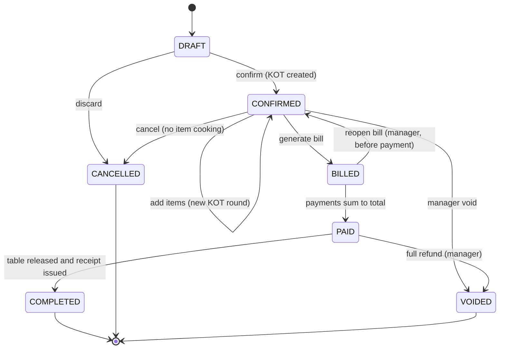
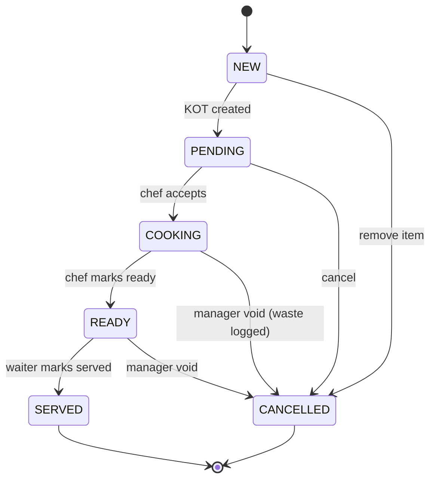

# M11 — Order Management
**System:** DineMaster  
**Module:** M11  
**Classification:** EDGE, OPS  
**Users:** All ordering roles  
**Document type:** Module-level technical specification

---

## 1. Purpose

M11 owns the complete order lifecycle in DineMaster. It manages order creation, draft editing, confirmation, additional item rounds, cancellation, voiding, billing transition, order history and reprint-related order operations.

M11 coordinates the order state machine with the item/KOT state machine and table state mapping defined in Chapter 7. It is the source of truth for order-level status transitions. KOT item preparation states remain item-level states; a KOT itself does not have an independent status.

## 2. Scope and responsibilities

### 2.1 In scope

- Create orders.
- Read order lists and order details.
- Edit draft order items.
- Confirm orders.
- Add items to an already running order as a new round.
- Cancel orders.
- Void orders.
- Transition eligible orders to billing.
- Reopen a bill before payment under Manager authority.
- Track payment/completion status through the defined lifecycle.
- Provide active orders, order details/timeline and filtered order history.
- Enforce legal state transitions, permissions, idempotency and optimistic locking.
- Coordinate Menu, Table, Kitchen, Payment and Inventory integrations.
- Support offline order creation on Edge and later synchronisation.

### 2.2 Related capabilities owned elsewhere

| Capability | Owning module |
|---|---|
| POS cart operations and parking | M10 — POS and Cart Management |
| Kitchen ticket creation and reprint | M13 — Kitchen Order Ticket |
| Kitchen Display System | M12 — KDS |
| Billing and invoice generation | M16 |
| Payment collection, refund execution and settlement | M17 |
| Table and floor management | M5 |
| Menu and product master data | M7 / M8 |
| Inventory deduction processing | Inventory modules |
| Offline synchronisation | M28 |

M11 controls order lifecycle transitions and invokes the relevant integrations. It must not duplicate the billing, payment, KOT, menu or inventory domain logic.

## 3. Users, permissions and visibility

The module is used by all ordering roles.

Source-defined permissions and access rules include:

| Operation | Permission / actor |
|---|---|
| Create order | `order:create` |
| View order | `order:view` |
| Update draft items | `order:update` |
| Cancel order | `order:cancel` |
| Void order | `order:void` |
| Generate bill | `bill:generate` |
| Record payment | `payment:record` |
| Refund payment | `payment:refund` |
| Update KOT item status | `kot:update_status` |

Additional source-defined visibility rule:

- A Waiter sees only their own orders.

The transition matrix in Chapter 7.2 also identifies specific actors for each state transition. The backend must validate both permission and business conditions. UI visibility alone is not authorization.

**[PROPOSED DETAIL]** Apply tenant and branch scoping to every order query and mutation. Verify that the actor is allowed to access the order's branch before returning order details or applying a transition.

## 4. Order lifecycle and stored states

### 4.1 Mapping user-facing lifecycle labels to persisted state

| Lifecycle label | Stored in | Stored value |
|---|---|---|
| Draft | `order.status` | `DRAFT` |
| Confirmed | `order.status` | `CONFIRMED` |
| KOT Generated | KOT row exists | `kot.created` event |
| Pending | `order_items.status` | `PENDING` |
| Cooking | `order_items.status` | `COOKING` |
| Ready | `order_items.status` | `READY` |
| Served | `order_items.status` | `SERVED` |
| Billed | `order.status` | `BILLED` |
| Paid | `order.status` | `PAID` |
| Completed | `order.status` | `COMPLETED` |

Important distinction:

- `KOT Generated` is represented by KOT record creation and the `kot.created` event, not by an order status.
- `Pending`, `Cooking`, `Ready` and `Served` are item states.
- The UI displays the combined label **In Kitchen** while any item is `PENDING`, `COOKING` or `READY`.
- A KOT has no independent status; its displayed state is derived from its items.

### 4.2 Order state machine



### 4.3 Allowed order transitions

Only the `(from, to)` pairs defined below are allowed. Any other transition must be rejected with `409 INVALID_TRANSITION`.

| From | To | Who / permission | Conditions | Side effects |
|---|---|---|---|---|
| `DRAFT` | `CONFIRMED` | Waiter, Cashier, Manager (`order:create`) | At least one item; table free or owned by this order | KOT created, table updated, `order.confirmed` event |
| `DRAFT` | `CANCELLED` | Creator or Manager | None specified | Order retained for audit |
| `CONFIRMED` | `BILLED` | Cashier, Manager (`bill:generate`) | No item in `NEW`, `PENDING`, `COOKING`, `READY`, unless Manager override | Invoice number assigned; totals frozen |
| `CONFIRMED` | `CANCELLED` | Cashier with reason, Manager | No item is `COOKING` or later | All items become `CANCELLED` |
| `CONFIRMED` | `VOIDED` | Manager (`order:void`) | Reason required | Stock-waste rule applies; `order.voided` event |
| `BILLED` | `PAID` | Cashier, Manager (`payment:record`) | Sum of successful payments equals total | `order.paid` event; stock deduction |
| `BILLED` | `CONFIRMED` | Manager | Only before any payment | Invoice voided; invoice number retained in log |
| `PAID` | `COMPLETED` | System | Receipt printed or skipped; table moved to cleaning | Order locked |
| `PAID` | `VOIDED` | Manager (`payment:refund`) | Refund recorded | Refund event |

The source uses `CONFIRMED → BILLED` for bill generation and `BILLED → CONFIRMED` for a Manager reopening before payment. Do not implement arbitrary status assignment from the client.

## 5. Item and KOT state machine

### 5.1 Item states



### 5.2 Item transition rules

| Transition | Who | Rule / side effect |
|---|---|---|
| `NEW → PENDING` | System during KOT creation | Item is included in a KOT |
| `PENDING → COOKING` | Chef (`kot:update_status`) | Set `accepted_at`; assign chef |
| `COOKING → READY` | Chef | Set `ready_at`; notify Waiter using `kot.item_status_changed` |
| `READY → SERVED` | Waiter for own tables, Manager | Table status may move to Served |
| `NEW → CANCELLED` | Remove before KOT | Item can be removed freely |
| `PENDING → CANCELLED` | Waiter or Cashier | No reason needed within 60 seconds; otherwise reason required |
| `COOKING → CANCELLED` | Manager only | Waste is logged |
| `READY → CANCELLED` | Manager only | Cancellation is treated as a manager void; reason/waste handling applies |
| Backward moves | Manager only | Reason required; logged as override |

A KOT has no status column/state of its own in this lifecycle definition. Derive its display state from its items:

- All items `PENDING` → Pending.
- Any item `COOKING` → In progress.
- All items `READY` or `SERVED` → Ready.

## 6. Table state integration

The source proposes the following minimum table statuses, while noting that the full list is pending confirmation from `database.md`:

`AVAILABLE`, `RESERVED`, `OCCUPIED`, `ORDERING`, `FOOD_PENDING`, `PREPARING`, `SERVED`, `BILL_REQUESTED`, `CLEANING`, `OUT_OF_SERVICE`.

Order and item events update table status as follows:

| Order / item event | Table status |
|---|---|
| Guests seated | `OCCUPIED` |
| Draft order started | `ORDERING` |
| Order confirmed | `FOOD_PENDING` |
| First item cooking | `PREPARING` |
| All items served | `SERVED` |
| Bill generated | `BILL_REQUESTED` |
| Order paid then completed | `CLEANING` |
| Staff marks table clean | `AVAILABLE` |

M11 must call the Table domain/service for the appropriate status update. The table status list is explicitly marked as proposed in the master document and must be confirmed before final schema constraints are frozen.

## 7. User journeys

### 7.1 Create and confirm an order

1. POS/Waiter client requests a new order.
2. M11 creates a `DRAFT` order.
3. Client adds or edits draft items.
4. Client requests confirmation with an `Idempotency-Key`.
5. M11 validates the draft, actor, branch, items, table ownership and current product price/availability.
6. M11 recalculates totals using the shared calculator.
7. M11 creates KOTs grouped by station.
8. M11 updates order and item statuses.
9. M11 updates the table status.
10. M11 writes audit/status logs and outbox events.
11. Transaction commits.
12. After commit, WebSocket notifications are broadcast and print jobs are enqueued.

### 7.2 Add items to a running order

- Adding items to a `CONFIRMED` order does not create a new order.
- New items are issued as a new KOT round with `round_no + 1`.
- Earlier KOTs remain unchanged.
- The order remains `CONFIRMED`.

### 7.3 Cancel versus void

- Whole-order cancellation is allowed only when no item is `COOKING` or later.
- If an item has reached `COOKING` or later, a Manager must use the void path where allowed.
- A `CONFIRMED → VOIDED` transition requires Manager authority and a reason.
- Stock-waste rules apply to voided orders.
- The order record is retained for audit.

### 7.4 Bill, pay and complete

- Billing is permitted when all items are `SERVED` or `CANCELLED`, unless a Manager override is used as defined by the billing transition rule.
- Bill generation assigns an invoice number and freezes totals.
- Payment transition requires successful payments whose sum equals the order total.
- Payment emits `order.paid`, which is consumed for stock deduction.
- The system completes the order after receipt is printed or skipped and the table is moved to cleaning.
- Completed orders are locked.

## 8. Screens and UI behavior

### 8.1 Active Orders

Displays current operational orders.

**[PROPOSED DETAIL]** Suggested list fields: order number, order type, table, waiter, guest count, current lifecycle label, amount and elapsed time. Exact columns and sort defaults are not specified by the source.

### 8.2 Order Detail with Timeline

Shows order details and the sequence of order/item lifecycle events.

The timeline should distinguish:
- Order-level status transitions.
- Item-level kitchen status transitions.
- KOT creation/additional rounds.
- Cancellation and void actions.
- Billing and payment events.

### 8.3 Order History

Source-defined filters:
- Date
- Status
- Type
- Table
- Waiter
- Amount

### 8.4 Void Dialog

Used for void operations. The source requires a reason for `CONFIRMED → VOIDED`, and audit records must capture the reason.

### 8.5 Events and UI states

Source-defined events:

- `OrderLoaded`
- `OrderConfirmRequested`
- `OrderCancelRequested`
- `OrderVoidRequested`

Source-defined states:

- `OrderDetailLoaded`
- `OrderTransitionFailed(code)`

## 9. Backend architecture

### 9.1 Source-defined components

| Component | Responsibility |
|---|---|
| `OrderController` | HTTP/API entry points |
| `OrderService` | Order use cases and orchestration |
| `OrderStateMachine` | Validates state transitions |
| `OrderNumberService` | Generates unique order numbers |
| `TotalsCalculator` | Calculates totals using the shared rule |

### 9.2 Design rules

- State changes must go through `OrderStateMachine`.
- `OrderService` should orchestrate transactional order operations.
- `TotalsCalculator` must use the shared calculation rules from Chapter 7.6.
- `OrderNumberService` must ensure uniqueness under concurrent load.
- Every state transition must be logged.
- Client requests must not directly set arbitrary status values.

**[PROPOSED DETAIL]** Keep controllers thin: validate request shape and authentication context, call application services, and map domain errors to stable HTTP responses. Avoid embedding transition rules in Flutter widgets or controller methods.

## 10. API specification

All endpoints below are defined in the master M11 API table.

| Method | Endpoint | Permission | Purpose |
|---|---|---|---|
| `POST` | `/api/v1/orders` | `order:create` | Create order |
| `GET` | `/api/v1/orders` | `order:view` | List/search orders |
| `GET` | `/api/v1/orders/{id}` | `order:view` | Get order detail |
| `PUT` | `/api/v1/orders/{id}/items` | `order:update` | Update draft items |
| `POST` | `/api/v1/orders/{id}/confirm` | `order:create` | Confirm order |
| `POST` | `/api/v1/orders/{id}/cancel` | `order:cancel` | Cancel order |
| `POST` | `/api/v1/orders/{id}/void` | `order:void` | Void order |
| `POST` | `/api/v1/orders/{id}/transfer` | `order:update` | Transfer order |

The lifecycle also defines bill, payment, reopen and completion transitions. The M11 endpoint table does not list dedicated endpoint paths for these actions; billing and payment are owned by M16/M17. Do not invent final route names without the corresponding module/API contract.

### 10.1 Error behavior

Source-defined errors:

| HTTP status / code | Meaning |
|---|---|
| `409 INVALID_TRANSITION` | Requested `(from, to)` transition is not allowed |
| `409 VERSION_CONFLICT` | Optimistic-lock version does not match |
| `422 IDEMPOTENCY_KEY_REUSED` | Same idempotency key reused with a different request body |
| `409` concurrent edit | Concurrent draft edit must be detected; version conflict is the defined mechanism |

**[PROPOSED DETAIL]** Return structured error bodies with stable `code`, human-readable `message` and optional field-level `details`. Keep the exact JSON envelope aligned with the project's API standard.

## 11. Confirmation transaction

The master document defines confirmation as a transactional operation.

### 11.1 Source-defined processing sequence

```text
confirmOrder(orderId, idempotencyKey, actor):
  if idempotency record exists for key: return stored response
  begin transaction (SERIALIZABLE on SQLite edge / READ COMMITTED + row lock on PG)
    order = load orderId FOR UPDATE
    assert order.status == DRAFT and order.items.count > 0
    assert actor has order:create and branch matches
    revalidate each item: product active, available, price == snapshot
    recalc totals with shared calculator (same code on edge and cloud)
    group NEW items by station -> one KOT per station per round
    for each KOT: insert kot, kot_items; set items PENDING
    order.status = CONFIRMED, order.confirmed_at = now
    table.status = FOOD_PENDING
    insert order_status_logs rows (ORDER and each ITEM)
    insert outbox rows: order.confirmed, kot.created
    save idempotency record with response
  commit
  after commit: WebSocket broadcast kot.created to KDS, order.updated to POS/waiters
  after commit: enqueue print job to station printer
```

### 11.2 Transaction guarantees

- Confirmation requires a draft order with at least one item.
- Actor must have `order:create`.
- Actor's branch must match the order branch.
- Every product must be active and available.
- Current product price must match the order snapshot.
- Totals are recalculated using the shared calculator.
- New items are grouped by station, producing one KOT per station per round.
- Order, KOT, item states, table status, status logs, outbox events and idempotency response are persisted within the transaction.
- SQLite Edge uses `SERIALIZABLE`; PostgreSQL uses `READ COMMITTED` plus row lock as specified.
- WebSocket broadcast and print enqueue happen after commit.

### 11.3 Post-commit failures

If WebSocket or printer fails after commit, the order remains valid.

- Clients re-fetch on reconnect.
- Print jobs are retried.
- Failed print jobs appear in a failed-prints list.
- A notification/print failure must not roll back an already committed order.

## 12. Idempotency and optimistic locking

### 12.1 Idempotency rules

1. Client generates a UUID `Idempotency-Key` per user action/button press.
2. Server stores `(tenant_id, key) → response` for 24 hours.
3. Repeated request with the same key returns the stored response; it does not create a second order.
4. Reusing the same key with a different request body returns `422 IDEMPOTENCY_KEY_REUSED`.
5. Buttons are disabled while a request is in flight.
6. Idempotency key is required on create and confirm.

### 12.2 Optimistic locking

- Updates send `If-Match: <version>`.
- If the version does not match, return `409 VERSION_CONFLICT`.
- The client should reload the latest order and reconcile the user's intended change rather than silently overwriting another edit.

## 13. Failed order recovery

| Failure scenario | Required recovery |
|---|---|
| App crash before confirm | Draft remains on Edge; reopen from Active Drafts |
| Network drop between client and Edge | Retry using the same idempotency key |
| Edge crash after commit but before broadcast | On restart, Edge re-broadcasts recent events; clients also poll every 10 seconds |
| KDS offline | Ticket waits; KDS requests events after `last_seq` on reconnect |
| Printer offline | Job stays queued, retries 3 times, then is flagged to Manager; KOT remains visible on KDS |
| Sync push rejected | Item goes to needs-review queue; local operation is not undone |

Offline order creation and later synchronisation are explicit M11 test requirements.

## 14. WebSocket events

Source-defined order and kitchen events:

| Event | Payload keys | Subscribers |
|---|---|---|
| `order.created` | `orderId`, `tableId`, `status` | POS, Waiter |
| `order.confirmed` | `orderId`, `kotIds` | POS, Waiter |
| `kot.created` | `kotId`, `station`, `items` | KDS for matching station |
| `kot.item_status_changed` | `kotId`, `itemId`, `from`, `to`, `by` | Waiter, POS, KDS |
| `kot.delay_alert` | `kotId`, `minutes` | KDS, Manager |
| `order.status_changed` | `orderId`, `from`, `to` | POS, Waiter |
| `table.status_changed` | `tableId`, `status` | POS, Waiter |
| `order.guest_ack` | `orderId` | Guest page |

The source also specifies that confirmation broadcasts `kot.created` to KDS and `order.updated` to POS/Waiters after commit. The event table uses `order.confirmed` for the order notification. Confirm the exact event naming contract during API/event schema finalisation; do not silently treat `order.updated` and `order.confirmed` as identical event names.

## 15. Audit and traceability

Every transition writes one `order_status_logs` row with:

- Entity
- From state
- To state
- Actor (`who`)
- Approver
- Reason
- Device
- Timestamp

Additional rules:

- Overrides always carry a reason.
- Voids always carry a reason.
- Audit rows are never updated or deleted.
- Draft cancellation is retained for audit.
- Invoice number is retained in the log when a bill is reopened before payment.

**[PROPOSED DETAIL]** Include correlation/request ID and idempotency key in operational logs so support teams can trace retries and duplicate submissions. These fields are useful additions but are not specified as columns in the source audit definition.

## 16. Data model

### 16.1 Tables

M11 uses:

- `ops.orders`
- `ops.order_items`
- `ops.order_status_logs`

The master document identifies the core operations schema in Chapter 6.6.

### 16.2 `ops.orders`

Relevant source-defined columns:

| Column | Meaning |
|---|---|
| `id` | Order UUID |
| `tenant_id` | Tenant scope |
| `branch_id` | Branch scope |
| `order_no` | Branch-unique order number |
| `order_type` | Dine-in/takeaway/delivery/online/walk-in |
| `channel` | POS/WAITER/QR/ONLINE |
| `table_id` | Optional table |
| `customer_id` | Optional customer |
| `waiter_id` | Optional waiter |
| `guest_count` | Guest count |
| `status` | Order lifecycle status |
| `subtotal` | Subtotal |
| `discount_amount` | Discount |
| `discount_remark` | Discount reason/remark |
| `tax_amount` | Tax total |
| `round_off` | Round-off |
| `total` | Final total |
| `notes` | Order notes |
| `parked` | POS parked flag |
| `idempotency_key` | Duplicate-request key |
| `origin_device_id` | Origin device |
| `created_by` | Creator |
| `confirmed_at` | Confirmation time |
| `completed_at` | Completion time |
| `version` | Optimistic-lock version |
| `deleted_at` | Soft-delete marker |

Order status constraint:

`DRAFT`, `CONFIRMED`, `BILLED`, `PAID`, `COMPLETED`, `CANCELLED`, `VOIDED`.

### 16.3 `ops.order_items`

Relevant source-defined columns:

| Column | Meaning |
|---|---|
| `id` | Item UUID |
| `tenant_id` | Tenant scope |
| `order_id` | Parent order |
| `product_id` | Soft reference to product |
| `product_name` | Product name snapshot |
| `unit_price` | Price snapshot |
| `tax_rate_percent` | Tax rate snapshot |
| `quantity` | Positive quantity |
| `line_total` | Line total |
| `spice_level` | Optional spice preference |
| `diet_pref` | Optional dietary preference |
| `notes` | Item notes |
| `status` | Item state |
| `cancel_reason` | Cancellation reason |
| `station` | Kitchen station |
| `version` | Item version |

Item status constraint:

`NEW`, `PENDING`, `COOKING`, `READY`, `SERVED`, `CANCELLED`.

### 16.4 Order number and indexes

The master schema gives an example order number:

`BR01-20261103-0042`

The source requires order-number uniqueness under load and defines a unique constraint on `(branch_id, order_no)`.

It also defines:
- Unique idempotency index on `(tenant_id, idempotency_key)` where the key is not null.
- Branch/status/created-time index for order listing.
- Table index for orders not in `COMPLETED`, `CANCELLED` or `VOIDED`.
- Order-item index on `order_id`.

### 16.5 SQL excerpt

This is a focused excerpt of the source schema, not a replacement for the full Chapter 6.6 migration.

```sql
CREATE SCHEMA IF NOT EXISTS ops;

CREATE TABLE ops.orders (
  id uuid PRIMARY KEY,
  tenant_id uuid NOT NULL,
  branch_id uuid NOT NULL,
  order_no varchar(30) NOT NULL,
  order_type varchar(15) NOT NULL CHECK (
    order_type IN ('DINE_IN','TAKEAWAY','DELIVERY','ONLINE','WALK_IN')
  ),
  channel varchar(15) NOT NULL DEFAULT 'POS' CHECK (
    channel IN ('POS','WAITER','QR','ONLINE')
  ),
  table_id uuid,
  customer_id uuid,
  waiter_id uuid,
  guest_count smallint,
  status varchar(15) NOT NULL DEFAULT 'DRAFT' CHECK (
    status IN ('DRAFT','CONFIRMED','BILLED','PAID','COMPLETED','CANCELLED','VOIDED')
  ),
  subtotal numeric(12,2) NOT NULL DEFAULT 0,
  discount_amount numeric(12,2) NOT NULL DEFAULT 0,
  discount_remark text,
  tax_amount numeric(12,2) NOT NULL DEFAULT 0,
  round_off numeric(5,2) NOT NULL DEFAULT 0,
  total numeric(12,2) NOT NULL DEFAULT 0,
  notes text,
  parked boolean NOT NULL DEFAULT false,
  idempotency_key varchar(64),
  origin_device_id uuid,
  created_by uuid NOT NULL,
  confirmed_at timestamptz,
  completed_at timestamptz,
  created_at timestamptz NOT NULL DEFAULT now(),
  updated_at timestamptz NOT NULL DEFAULT now(),
  version integer NOT NULL DEFAULT 1,
  deleted_at timestamptz,
  UNIQUE (branch_id, order_no)
);

CREATE UNIQUE INDEX ux_orders_idem
  ON ops.orders (tenant_id, idempotency_key)
  WHERE idempotency_key IS NOT NULL;

CREATE INDEX ix_orders_branch_status
  ON ops.orders (branch_id, status, created_at DESC);

CREATE INDEX ix_orders_table
  ON ops.orders (table_id)
  WHERE status NOT IN ('COMPLETED','CANCELLED','VOIDED');

CREATE TABLE ops.order_items (
  id uuid PRIMARY KEY,
  tenant_id uuid NOT NULL,
  order_id uuid NOT NULL REFERENCES ops.orders(id),
  product_id uuid NOT NULL,
  product_name varchar(150) NOT NULL,
  unit_price numeric(12,2) NOT NULL,
  tax_rate_percent numeric(5,2) NOT NULL,
  quantity numeric(8,2) NOT NULL CHECK (quantity > 0),
  line_total numeric(12,2) NOT NULL,
  spice_level varchar(15),
  diet_pref varchar(20),
  notes text,
  status varchar(12) NOT NULL DEFAULT 'NEW' CHECK (
    status IN ('NEW','PENDING','COOKING','READY','SERVED','CANCELLED')
  ),
  cancel_reason text,
  station varchar(30),
  created_at timestamptz NOT NULL DEFAULT now(),
  updated_at timestamptz NOT NULL DEFAULT now(),
  version integer NOT NULL DEFAULT 1
);

CREATE INDEX ix_items_order ON ops.order_items (order_id);
```

The source references `order_status_logs` but the complete DDL for that table is not included in the retrieved M11 excerpts. Use the audit field contract in Section 15 and confirm the canonical DDL in the database migration source before implementation.

## 17. Integrations and dependencies

| Module/domain | M11 interaction |
|---|---|
| Menu / Product | Validate product active state, availability and price snapshot |
| Table | Validate table availability/ownership and update table status |
| Kitchen / KOT | Create KOTs on confirmation and additional rounds |
| Payment | Receive payment lifecycle outcome; payment module owns payment processing |
| Inventory | Consume `order.paid` / void-related events for stock movement |
| M10 POS | Creates and edits draft carts; requests confirmation |
| M28 Sync | Synchronises local Edge orders and changes to Cloud |

M11 calls Menu for price validation, Table for status, Kitchen for KOT, Payment and Inventory through events/integrations.

## 18. Totals and price consistency

M11 uses the shared totals calculator defined in Chapter 7.6. It must not implement a second calculation formula.

At confirmation:
- Revalidate product active state.
- Revalidate product availability.
- Revalidate that current price equals the order's price snapshot.
- Recalculate totals with the same calculator code on Edge and Cloud.

The Chapter 7.6 calculation includes subtotal, flat/percentage discount, proportional discount allocation across taxable lines, per-slab tax rounding and round-off. The round-off-to-nearest-rupee rule is explicitly marked `[ASSUMPTION]`, and exact GST rules remain pending tax review (Pending P6).

## 19. Testing strategy

### 19.1 Required tests from the master document

| Test | Expected result |
|---|---|
| Every transition pair | Valid transitions succeed; invalid transitions are rejected |
| Double confirm | Duplicate confirmation does not create duplicate KOT/order side effects |
| Concurrent edit | Stale version is rejected with `409` |
| Offline create and later sync | Order is created locally and synchronised later |
| Order-number uniqueness | Uniqueness proven under load |

### 19.2 Recommended test matrix

The following cases expand the source-defined requirements and are **[PROPOSED DETAIL]**:

**Order creation and editing**
1. Create a draft with a valid order type.
2. Reject an unauthorised create request.
3. Reject cross-tenant or cross-branch order access.
4. Update draft items with a matching `If-Match` version.
5. Reject edits to a non-editable lifecycle state.
6. Ensure Waiter can only view their own orders.

**Confirmation**
7. Reject confirmation with zero items.
8. Reject confirmation if table is neither free nor owned by the order.
9. Reject confirmation if product is inactive.
10. Reject confirmation if product is unavailable.
11. Reject confirmation if product price differs from the saved snapshot.
12. Verify shared totals calculator result.
13. Verify one KOT per station per round.
14. Verify item states become `PENDING`.
15. Verify order becomes `CONFIRMED`.
16. Verify table becomes `FOOD_PENDING`.
17. Verify audit and outbox rows are committed atomically.
18. Verify WebSocket/print failure after commit does not invalidate the order.

**Lifecycle and cancellation**
19. Test each allowed order transition.
20. Test each invalid order transition and `409 INVALID_TRANSITION`.
21. Cancel a draft and verify audit retention.
22. Cancel a confirmed order when no item is cooking or later.
23. Reject whole-order cancellation when an item is cooking or later.
24. Verify Manager void requires reason and records waste-related event.
25. Verify adding a round leaves previous KOTs unchanged.
26. Verify billing readiness requires served/cancelled items unless Manager override is used.
27. Verify payment transition requires successful payment sum equal to total.
28. Verify completion locks the order.

**Idempotency and recovery**
29. Retry create with same key/body; return stored response.
30. Retry confirm with same key/body; do not create duplicate KOTs.
31. Reuse key with different body; return `422 IDEMPOTENCY_KEY_REUSED`.
32. Expired idempotency record behavior is tested against the 24-hour policy.
33. Crash before confirm; draft is recoverable.
34. Network drop; retry same idempotency key.
35. Edge restart after commit; event replay works.
36. Offline create followed by sync does not duplicate the order.

## 20. Performance and reliability

Source-defined reliability requirements:

- Order number uniqueness must be proven under load.
- Concurrent edit must be detected using optimistic locking.
- Create and confirm must be idempotent.
- Offline order creation and later sync must work.
- Edge restart must recover recent events after commit/before broadcast.

**[PROPOSED DETAIL]** Benchmark order creation, confirmation transaction duration, active-order query latency and event replay throughput on target Edge hardware. Numeric latency SLAs are not specified in the M11 source.

## 21. Implementation sequence

The master document specifies:

1. State machine and calculator first.
2. Endpoints next.
3. Flutter implementation after endpoints.

Recommended engineering checkpoints (**[PROPOSED DETAIL]**):

- Finalise transition matrix and automated state-machine tests.
- Integrate shared calculator and golden test vectors.
- Implement order repository, order number generation and audit logging.
- Implement idempotency and optimistic locking.
- Implement confirmation transaction with KOT/table/outbox integration.
- Implement history filters and order timeline.
- Integrate Flutter screens and offline recovery.
- Run concurrency, failure-recovery and load tests.

## 22. Acceptance criteria

M11 is ready when:

- Orders can be created and draft items edited through authorised endpoints.
- Order lifecycle transitions exactly follow Chapter 7.2.
- Invalid transitions return `409 INVALID_TRANSITION`.
- Confirmation validates actor, branch, items, table and price snapshots.
- Confirmation creates KOTs grouped by station and updates items to `PENDING`.
- Table status is updated as specified.
- Order and item status changes are audited.
- Idempotency is enforced on create and confirm.
- Optimistic locking rejects stale updates with `409 VERSION_CONFLICT`.
- Add-on rounds create a new KOT round without modifying earlier KOTs.
- Cancel and void permissions/reasons are enforced.
- Billing, payment and completion transitions follow the defined conditions.
- Waiter visibility is limited to own orders.
- Offline create and later sync work without duplicate orders.
- Order number uniqueness is proven under load.
- Active orders, detail timeline and filtered history are available.

## 23. Open decisions and source gaps

1. **Order status and item status ownership:** Confirm that UI aggregation never writes derived kitchen labels into `order.status`.
2. **Order number generation:** Format example exists (`BR01-YYYYMMDD-####`), but sequence reset, branch counter storage and offline multi-device allocation need final implementation detail.
3. **`order_status_logs` DDL:** Table is referenced, but full canonical DDL was not present in the retrieved M11 excerpt.
4. **Bill and payment endpoints:** Lifecycle transitions are specified, but M11 endpoint table does not list bill/payment routes; those belong to M16/M17.
5. **Transfer endpoint semantics:** `POST /orders/{id}/transfer` is listed, while table transfer is marked Target in Chapter 7.7. Clarify whether this endpoint is order reassignment, waiter transfer or table transfer before implementation.
6. **Reprint ownership:** M11 feature list mentions reprint, while M13 owns KOT reprint. Clarify whether M11 reprint means order summary/receipt reprint or a navigation action to M13/M16.
7. **Manager overrides:** The source permits some Manager overrides but does not fully specify approval UI, override permission keys or mandatory reason for every override case.
8. **Payment partials:** `BILLED → PAID` requires successful payment sum to equal total. Split/partial payment behavior belongs to M17 and must be reconciled with this rule.
9. **Refund semantics:** `PAID → VOIDED` is specified for full refund; partial refund behavior is not detailed here.
10. **Table status list:** Full authoritative status list remains pending from `database.md`; the minimum list is labelled proposed.
11. **Event naming:** Confirmation processing text mentions `order.updated`, while the event catalogue lists `order.confirmed`. Final event contract must settle this.
12. **Offline order numbering:** Unique branch order numbers must remain safe when multiple Edge devices create orders offline; the exact allocation strategy is not defined in the M11 excerpt.
13. **History pagination and retention:** Filters are defined, but pagination, export, retention and archival rules are not.
14. **Order transfer:** Exact source/destination ownership, audit and table side effects require clarification.

## 24. Deliverables

Source-defined deliverables and implementation order:

- Order state machine.
- Shared totals calculator.
- Order APIs/endpoints.
- Flutter order-management UI.
- Unique order numbering.
- Idempotency and optimistic locking.
- Offline create and later sync support.

Recommended supporting artifacts (**[PROPOSED DETAIL]**):

- OpenAPI specification.
- State-transition test matrix.
- Order-number concurrency test report.
- Idempotency/recovery test report.
- Event contract/schema.
- Audit schema migration.
- Offline order recovery runbook.

---

**End of M11 — Order Management**
