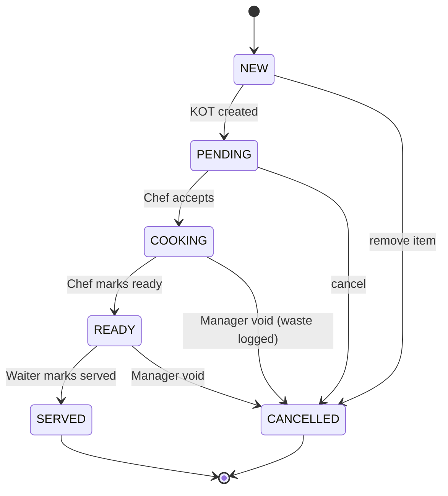

# M12 — Kitchen Display System (KDS)
**System:** DineMaster  
**Module:** M12  
**Classification:** EDGE, OPS  
**Primary users:** Chef, Manager  
**Document type:** Module-level technical specification

---

## 1. Purpose

The Kitchen Display System (KDS) is DineMaster's paperless kitchen screen. It receives kitchen tickets generated by the Order/KOT workflow, presents live tickets by kitchen station, and allows kitchen staff to accept and progress items through preparation.

M12 provides:
- Live tickets grouped/filtered by station.
- Ticket sorting.
- Preparation timers.
- Delay alerts and reason capture.
- Chef assignment.
- Ticket history/archive.
- Kitchen speed metrics.
- Real-time WebSocket updates with a 10-second polling fallback.

M12 is an EDGE and OPS module. It is fed by Order/KOT workflows and informs Waiter and Dashboard experiences.

## 2. Scope and ownership

### 2.1 In scope

- Display live KOTs/tickets for the relevant kitchen station.
- Receive new KOT notifications.
- Show ticket and item details.
- Allow Chef to accept items, moving them to `COOKING`.
- Allow Chef to mark items `READY`.
- Notify Waiter when items become ready.
- Assign a Chef to a ticket.
- Mark a ticket as priority/urgent.
- Sort tickets by supported sorting modes.
- Track preparation timers.
- Raise delay alerts and capture delay reasons.
- Browse kitchen history/archive.
- Calculate preparation speed metrics.
- Reconnect and replay missed events after a connection interruption.
- Enforce kitchen-specific data visibility.

### 2.2 Outside M12 ownership

| Capability | Owning module / domain |
|---|---|
| Order creation and confirmation | M11 — Order Management |
| KOT generation and immutable ticket contents | M13 — Kitchen Order Ticket |
| Menu/product master data | M7 / M8 |
| Table/floor state | M5 |
| Waiter order experience | Waiter module |
| Dashboard reporting | Dashboard module |
| Printing and print-job retries | M13 / Print subsystem |

M12 consumes KOTs created by the order workflow. It does not independently create or edit the commercial order. The KOT content is immutable after creation; changes to a running order are represented by new KOT rounds or cancellation notices under M13.

## 3. Users, roles and access control

### 3.1 Users

- **Chef:** views assigned/relevant station tickets, accepts work, marks items ready.
- **Manager:** monitors kitchen operations, assigns chefs, handles overrides and delay monitoring.

### 3.2 Access rules

Source-defined security rules:

- Chef cannot see product prices.
- Chef cannot see customer data.
- Overrides are logged.

**[PROPOSED DETAIL]** Apply branch and station scope on every KDS query and mutation. A Chef should only receive tickets for stations they are authorised to work on. The master excerpt does not define the exact station-assignment permission model, so the final RBAC permission keys need to be confirmed.

## 4. Kitchen ticket lifecycle

### 4.1 Item lifecycle

KDS displays the item-level lifecycle defined in Chapter 7.3:



### 4.2 KDS actions

| Current item state | Action | Next state | Actor |
|---|---|---|---|
| `PENDING` | Accept | `COOKING` | Chef |
| `COOKING` | Mark Ready | `READY` | Chef |
| `READY` | Mark Served | `SERVED` | Waiter for own tables, Manager |
| `COOKING` / `READY` | Cancel/void | `CANCELLED` | Manager under order cancellation rules |

M12's primary kitchen actions are `PENDING → COOKING` and `COOKING → READY`. Serving is a Waiter/Manager action and is reflected back to KDS as an item state update.

### 4.3 Transition metadata

- On `PENDING → COOKING`, set `accepted_at` and assign the Chef.
- On `COOKING → READY`, set `ready_at`.
- When an item becomes ready, notify the Waiter using `kot.item_status_changed`.
- Backward moves are Manager-only, require a reason and must be logged as overrides.
- Simultaneous acceptance by two Chefs must be resolved so only one succeeds.

### 4.4 KOT state is derived

A KOT has no independent status of its own. Its display state is derived from its items:
- All items `PENDING` → Pending.
- Any item `COOKING` → In progress.
- All items `READY` or `SERVED` → Ready.

Do not introduce a separate persisted KOT status unless a future schema decision explicitly requires it.

## 5. Ticket station routing and board behavior

### 5.1 Station-based tickets

- KDS displays live tickets by station.
- A KOT is routed to the matching kitchen station.
- A KOT created for a station is delivered to the KDS subscribed to that station.
- The source identifies station examples in the project overview: Chinese, Tandoor, Fast Food, Main Course, Bakery and Beverages.

### 5.2 Supported sorting modes

The station board supports:

1. Oldest First
2. Priority
3. Table
4. Fastest Prep

The source does not define tie-breakers or exact ascending/descending behavior for every sort. Those details should be agreed before UI and query ordering are finalised.

### 5.3 Ticket content

**[PROPOSED DETAIL]** A practical ticket card may display KOT number, order/table reference, station, round number, item names, quantities, item notes/customisations, elapsed time, priority indicator and assigned Chef. Do not display prices or customer personal data to Chef.

The exact field list and layout dimensions are not fully specified in the M12 source.

## 6. Timers, delay alerts and preparation metrics

### 6.1 Timers

- KDS displays preparation timers.
- Prep metric is defined as:

```text
prep_duration = ready_at - accepted_at
```

This measures the elapsed preparation duration between Chef acceptance and item readiness.

### 6.2 Delay alerts

- KDS supports delay alerts with reason capture.
- Delay reason is mandatory after the configured threshold.
- Delay reason submissions are auditable.
- Manager can monitor delayed tickets.

The master module text does not specify the exact delay threshold.

### 6.3 Ticket age colours

The source gives the following default colour thresholds, explicitly marked as an assumption:

| Ticket age | Colour | Status |
|---|---|---|
| Under 10 minutes | Green | `[ASSUMPTION]` |
| 10–15 minutes | Amber | `[ASSUMPTION]` |
| Over 15 minutes | Red | `[ASSUMPTION]` |

These are provisional UI defaults, not confirmed operational policy. Make thresholds configurable only after the product owner confirms whether the defaults should be retained.

### 6.4 Delay reason capture

The module exposes a delay-reason action:

`POST /api/v1/kitchen-tickets/{kotId}/delay-reason`

The source schema excerpt identifies:

`kitchen_delays(id, kot_id, reason, minutes, recorded_by)`

**[PROPOSED DETAIL]** Capture the reason against the relevant ticket and actor, and retain the recorded duration used for reporting. The source does not specify a delay-reason enum or whether multiple delay records per KOT are allowed.

## 7. Chef assignment and priority

### 7.1 Chef assignment

The module supports Chef assignment through:

`POST /api/v1/kitchen-tickets/{kotId}/assign-chef`

The KDS workflow sets the Chef assignment when an item is accepted (`PENDING → COOKING`).

The source does not specify:
- Whether assignment is ticket-level or item-level in all cases.
- Whether a Chef may be assigned to multiple tickets simultaneously.
- Whether assignment can be changed after cooking begins.
- Whether assignment requires a Manager permission or Chef self-assignment is allowed.

These are open implementation decisions.

### 7.2 Priority

The module supports a priority/urgent action:

`POST /api/v1/kitchen-tickets/{kotId}/priority`

Priority is also a supported sorting mode. The source does not define priority levels, default priority, who may set priority, or whether priority changes require a reason.

## 8. Screens and user interaction

### 8.1 Station Board

Main operational screen:
- Live tickets for a station.
- Sorting controls: Oldest First, Priority, Table, Fastest Prep.
- Preparation timers.
- Delay alerts.
- Chef assignment and priority indicators.
- New-ticket sound alert.
- Connection/reconnection status.

### 8.2 Ticket Detail

**[PROPOSED DETAIL]** Provide a focused view for item notes/customisations and the Chef's Accept/Ready actions. Preserve large touch targets for kitchen hardware.

### 8.3 History

- History archive is a required feature.
- Speed metrics are available from preparation timestamps.

The source does not define history filters, retention, export or pagination. Confirm these before implementing a reporting contract.

### 8.4 UI events and states

Source-defined events:

- `KotReceived`
- `ItemAccepted`
- `ItemReady`
- `SortChanged`
- `DelayReasonSubmitted`

Source-defined UI states:

- `KdsLoaded`
- `KdsDisconnected`

Source-defined UI behavior:

- Large touch targets.
- Sound alert on a new ticket.
- “Reconnecting” banner when disconnected.

## 9. Real-time communication and reconnect behavior

### 9.1 WebSocket and fallback polling

- KDS uses WebSocket for live ticket updates.
- A 10-second polling fallback is required.
- When a ticket is created, the matching station KDS receives `kot.created`.
- When an item changes state, the KDS receives `kot.item_status_changed`.

### 9.2 Event replay

If KDS disconnects:
1. Show the “Reconnecting” banner.
2. Re-establish the WebSocket connection.
3. Request missed events after the last processed sequence (`last_seq`).
4. Reconcile the board with the server's current ticket state.
5. Resume live updates.

The master order workflow explicitly states that a KDS reconnects by requesting events after `last_seq`.

### 9.3 Relevant event contracts

| Event | Payload keys | Subscribers |
|---|---|---|
| `kot.created` | `kotId`, `station`, `items` | KDS for matching station |
| `kot.item_status_changed` | `kotId`, `itemId`, `from`, `to`, `by` | Waiter, POS, KDS |
| `kot.delay_alert` | `kotId`, `minutes` | KDS, Manager |

The KDS UI event names (`KotReceived`, `ItemAccepted`, `ItemReady`) are client-side interaction/state events; they are distinct from server WebSocket event names.

**[PROPOSED DETAIL]** Make event handlers idempotent and reconcile from authoritative ticket state after reconnect. Do not assume every WebSocket message will be delivered exactly once.

## 10. Backend architecture

### 10.1 Source-defined components

| Component | Responsibility |
|---|---|
| `KitchenController` | KDS API entry points |
| `KitchenService` | Kitchen use cases and orchestration |
| `KotQueryService` | Station ticket retrieval and query operations |

### 10.2 Responsibility boundaries

- `KitchenController` handles HTTP request/response mapping.
- `KitchenService` coordinates Chef actions, priority, assignment and delay recording.
- `KotQueryService` retrieves tickets for station/status filters and history views.
- KOT creation remains owned by the Order/KOT workflow.
- Item state transitions must follow Chapter 7.3.
- Overrides must be audited.

**[PROPOSED DETAIL]** Keep the item transition validation in a shared domain service or state-machine component so KDS and any other client cannot implement conflicting transition rules.

## 11. API specification

All endpoints below are explicitly listed in the M12 module specification.

| Method | Endpoint | Purpose |
|---|---|---|
| `GET` | `/api/v1/kitchen-tickets?station=&status=` | Retrieve tickets by station and status |
| `PUT` | `/api/v1/kitchen-tickets/{kotId}/items/{itemId}/status` | Update item status |
| `POST` | `/api/v1/kitchen-tickets/{kotId}/priority` | Set ticket priority |
| `POST` | `/api/v1/kitchen-tickets/{kotId}/delay-reason` | Record delay reason |
| `POST` | `/api/v1/kitchen-tickets/{kotId}/assign-chef` | Assign Chef |

### 11.1 API behavior

**GET `/api/v1/kitchen-tickets?station=&status=`**
- Retrieves kitchen tickets filtered by station and status.
- Chef must not receive prices or customer data.
- **[PROPOSED DETAIL]** Enforce branch/station access on the server, not only in client filters.

**PUT `/api/v1/kitchen-tickets/{kotId}/items/{itemId}/status`**
- Updates the state of an item within a KOT.
- Main Chef transitions: `PENDING → COOKING` and `COOKING → READY`.
- Set `accepted_at` and Chef assignment on accept.
- Set `ready_at` on ready.
- Enforce transition authorization and concurrency so only one of two simultaneous Chef accepts wins.

**POST `/api/v1/kitchen-tickets/{kotId}/priority`**
- Sets or updates ticket priority.
- Exact priority values and permission rules are not specified.

**POST `/api/v1/kitchen-tickets/{kotId}/delay-reason`**
- Records delay reason and duration.
- Reason is mandatory after the configured threshold.

**POST `/api/v1/kitchen-tickets/{kotId}/assign-chef`**
- Assigns a Chef to the ticket.
- Exact assignment policy remains to be confirmed.

The source does not provide request/response JSON schemas, so payload field names beyond the documented route and domain fields should be finalised in the OpenAPI contract rather than guessed.

## 12. Data model

### 12.1 Source-defined tables

| Table | Purpose |
|---|---|
| `ops.kots` | KOT header records |
| `ops.kot_items` | Items belonging to a KOT |
| `kitchen_delays` | Delay reason and duration records |

KOT and item schema are referenced in Chapter 6.6. M12's module excerpt gives the delay table shape:

`kitchen_delays(id, kot_id, reason, minutes, recorded_by)`

### 12.2 Relevant item timestamps

The KDS uses:
- `accepted_at` — set when Chef accepts the item.
- `ready_at` — set when Chef marks the item ready.

Preparation metric:

```sql
-- Conceptual metric; exact timestamp column types follow the canonical schema.
ready_at - accepted_at
```

### 12.3 Delay table SQL

The following is a **[PROPOSED DETAIL]** illustrative DDL based only on the source-listed fields. Confirm schema namespace, key types, foreign keys and timestamp conventions against the canonical database migration before applying it.

```sql
CREATE TABLE ops.kitchen_delays (
  id uuid PRIMARY KEY,
  kot_id uuid NOT NULL REFERENCES ops.kots(id),
  reason text NOT NULL,
  minutes integer NOT NULL,
  recorded_by uuid NOT NULL,
  created_at timestamptz NOT NULL DEFAULT now()
);
```

Do not treat this illustrative statement as a confirmed migration.

## 13. Security and privacy

Source-defined:
- Chef cannot see prices.
- Chef cannot see customer data.
- Overrides are logged.

**[PROPOSED DETAIL]** Additional implementation controls:
- Apply tenant, branch and station scoping to all KDS reads and writes.
- Return only the fields needed for kitchen execution.
- Validate that the `itemId` belongs to the supplied `kotId`.
- Validate that the KOT belongs to the active tenant and branch.
- Record actor identity for state changes, assignment, priority and delay submissions.
- Do not trust a client-provided Chef ID without checking the authenticated actor's permissions.

The exact RBAC permission names for KDS actions are not specified in the M12 source.

## 14. Failure handling and concurrency

### 14.1 Required scenarios

The M12 test requirements include:
- Reconnect replay.
- Simultaneous acceptance by two Chefs (one wins).
- Delayed alert.

### 14.2 Expected behavior

| Scenario | Expected behavior |
|---|---|
| WebSocket disconnect | Show reconnecting banner; use 10-second polling fallback |
| KDS reconnect | Request events after `last_seq` and reconcile board |
| Two Chefs accept same item | Only one acceptance succeeds |
| Delayed ticket | Raise alert and require reason after configured threshold |
| New KOT arrives | Show ticket and play sound alert |
| Chef marks item ready | Set `ready_at`; notify Waiter |
| Manager override | Enforce authorization, require reason where Chapter 7.3 applies, and audit |

**[PROPOSED DETAIL]** Use a conditional update/row lock or equivalent concurrency control for item acceptance. The operation should only transition an item from `PENDING` to `COOKING` if it is still `PENDING`; the losing Chef should receive a conflict response and refresh the ticket.

## 15. Testing strategy

### 15.1 Source-defined tests

| Test | Expected result |
|---|---|
| Reconnect replay | Missed events after `last_seq` are recovered |
| Simultaneous two-Chef accept | One Chef wins; duplicate acceptance is rejected |
| Delayed alert | Alert is raised and reason is captured after threshold |
| Kitchen hardware burn-in | KDS remains stable during prolonged operation |
| Screen sleep disabled | Kitchen display does not enter sleep during operation |

### 15.2 Recommended detailed test matrix

The following expands the source requirements and is **[PROPOSED DETAIL]**.

**Ticket retrieval**
1. Retrieve tickets for a valid station.
2. Filter by status.
3. Ensure one station cannot retrieve another station's tickets without permission.
4. Ensure Chef responses exclude prices and customer data.
5. Ensure archived/history tickets are not mixed into the active board unless requested.

**Item state transitions**
6. Accept a `PENDING` item; verify `COOKING`.
7. Verify `accepted_at` is set.
8. Verify Chef assignment is recorded.
9. Mark a `COOKING` item ready; verify `READY`.
10. Verify `ready_at` is set.
11. Verify Waiter receives `kot.item_status_changed`.
12. Reject invalid item state transitions.
13. Verify Manager-only backward override behavior and audit.

**Priority and assignment**
14. Set ticket priority and verify Priority sort.
15. Assign Chef and verify board display.
16. Reject unauthorised assignment/priority changes.

**Timers and delay**
17. Verify elapsed timer display.
18. Verify prep metric equals `ready_at - accepted_at`.
19. Verify delay alert threshold behavior.
20. Verify delay reason is mandatory after threshold.
21. Verify delay record stores actor and duration.

**Real-time and recovery**
22. Receive a newly created KOT over WebSocket.
23. Verify new-ticket sound alert.
24. Disconnect WebSocket and show reconnecting banner.
25. Verify 10-second polling fallback.
26. Reconnect and replay events after `last_seq`.
27. Reconcile current ticket state without duplicate cards or repeated state changes.

**Reliability**
28. Simultaneous Chef acceptance: one success only.
29. Kitchen hardware burn-in test.
30. Verify screen sleep is disabled/configured for the KDS device.

## 16. Performance and operational requirements

Source-defined:
- WebSocket live updates.
- 10-second polling fallback.
- Burn-in test on kitchen hardware.
- Screen sleep disabled.
- Preparation speed metrics.
- Ticket sorting by four supported modes.

**[PROPOSED DETAIL]** Benchmark:
- Time from KOT commit to station-board visibility.
- Board refresh and query performance with realistic peak ticket counts.
- Reconnect replay duration for a representative outage.
- Polling load across multiple kitchen displays.
- UI responsiveness on target kitchen hardware.

No numeric latency, concurrent-device or retention SLA is specified in the M12 module excerpt.

## 17. Implementation sequence

The source specifies this implementation order:

1. Edge endpoints.
2. WebSocket events.
3. Flutter board.

Recommended engineering checkpoints (**[PROPOSED DETAIL]**):
1. Confirm KOT/item data contract and station mapping.
2. Implement station/status query.
3. Implement item state transition endpoint with concurrency protection.
4. Implement Chef assignment, priority and delay-reason actions.
5. Implement WebSocket subscription and event replay.
6. Add 10-second polling fallback.
7. Build Flutter Station Board, Ticket Detail and History screens.
8. Add sound alert, reconnect banner and timer behavior.
9. Run concurrency, reconnect and kitchen-hardware burn-in tests.

## 18. Acceptance criteria

M12 is ready when:

- KDS displays live tickets by station.
- Ticket sorting supports Oldest First, Priority, Table and Fastest Prep.
- New ticket appears on the matching station board.
- New-ticket sound alert works.
- Chef can accept a pending item and move it to `COOKING`.
- Chef can mark a cooking item `READY`.
- `accepted_at` and `ready_at` are recorded correctly.
- Waiter is notified when an item becomes ready.
- Delay alerts and reason capture work.
- Chef assignment works according to the approved assignment policy.
- Priority action and Priority sorting work.
- History/archive and speed metrics are available.
- WebSocket updates work with 10-second polling fallback.
- Reconnect replay uses `last_seq`.
- Simultaneous acceptance by two Chefs allows only one winner.
- Chef cannot see prices or customer data.
- Overrides are logged.
- Kitchen hardware burn-in passes and screen sleep is disabled.

## 19. Open decisions and source gaps

1. **Delay threshold:** Exact delay-alert threshold is not specified.
2. **Ticket age colours:** Green under 10 minutes, amber 10–15 and red over 15 are explicitly `[ASSUMPTION]`; obtain product-owner approval.
3. **Priority model:** Priority values, default value, allowed actors and reason requirements are not defined.
4. **Chef assignment:** Confirm whether assignment is ticket-level or item-level, who may assign, and whether reassignment is allowed after cooking starts.
5. **Station permissions:** Exact role/permission mapping for Chef station access is not listed.
6. **Ticket card fields:** Exact display fields and ordering are not fully defined. Chef must not see prices/customer data.
7. **History:** Filters, pagination, retention, export and archive rules are unspecified.
8. **Delay records:** Confirm whether multiple delay records per KOT are allowed and whether `minutes` is manually entered or calculated.
9. **API payloads:** Request/response JSON schemas and error codes are not provided.
10. **Event sequence:** Confirm the source of `last_seq`, replay retention window and behavior when the requested sequence is too old.
11. **Polling scope:** Confirm whether the 10-second fallback polls the full station board or only when WebSocket is disconnected.
12. **Concurrency response:** The source requires one Chef to win but does not specify the exact HTTP conflict code/body for the losing request.
13. **KOT/item schema:** Full canonical DDL is in Chapter 6.6 and should be used rather than creating parallel KDS-specific ticket tables.
14. **Kitchen hardware:** Device specifications, screen resolution, audio policy and burn-in duration are not defined.

## 20. Deliverables

Source-defined deliverables:

- Edge endpoints.
- WebSocket events.
- Flutter KDS board.

Supporting artifacts (**[PROPOSED DETAIL]**):

- OpenAPI contract for KDS endpoints.
- WebSocket event schema and replay contract.
- Station/role access matrix.
- Item transition concurrency test report.
- Delay threshold and colour policy approval.
- Kitchen hardware burn-in test report.
- KDS operational troubleshooting runbook.

---

**End of M12 — Kitchen Display System (KDS)**
