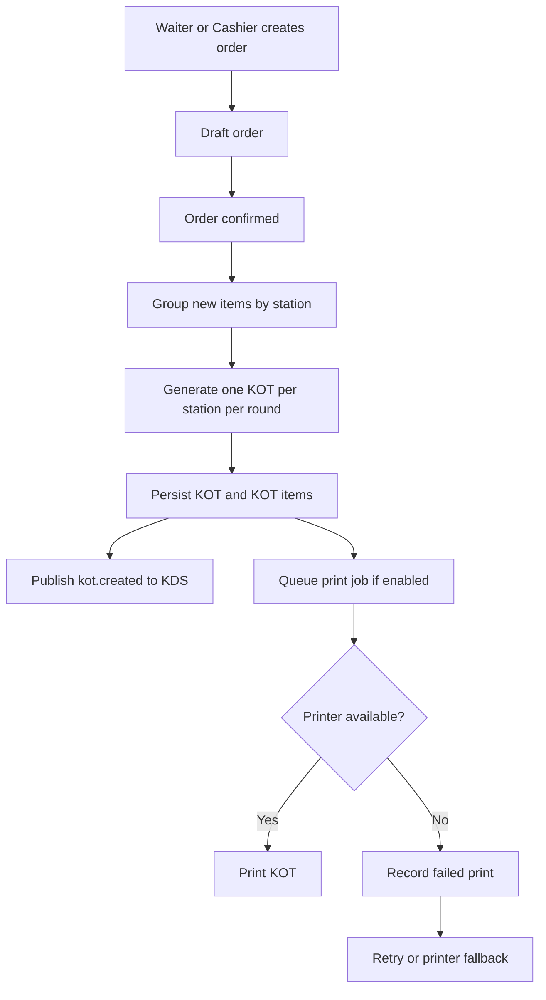

# M13 — Kitchen Order Ticket (KOT)

**Project:** DineMaster  
**Module:** M13 — Kitchen Order Ticket  
**Scope:** EDGE, OPS  
**Status:** Draft — proposed implementation details are explicitly labelled.

## 1. Purpose

A Kitchen Order Ticket (KOT) is the printed or digital instruction sent to the kitchen after an order is confirmed. M13 owns KOT generation, numbering, immutable ticket content, add-on rounds, cancellation notices, urgent flags, reprinting and print-job orchestration.

**Users:** System, Waiter, Cashier and Chef.

### Goals
- Automatically generate KOTs at order confirmation.
- Generate one KOT per station per round.
- Allocate a KOT number per branch per day.
- Preserve KOT content after creation.
- Represent additions as new KOT rounds and cancellations as cancellation notices.
- Support optional printing, KDS delivery, reprints and failed-print tracking.

### Non-goals
- Kitchen preparation board and item status workflow (M12 KDS).
- Full order lifecycle (M11 Order Management).
- Printer hardware configuration (M25 Printer Integration).
- Order price and tax calculation.

## 2. Functional requirements

### 2.1 Generation
When an order is confirmed:
1. M11 validates and confirms the order.
2. New order items are grouped by kitchen station.
3. One KOT is generated per station for that order round.
4. KOT items are linked to the corresponding order items.
5. The KOT is made available to KDS.
6. A print job is queued if printing is enabled for the station.

### 2.2 Immutability
KOT content is immutable after creation:
- Never edit an existing KOT to add items.
- Add-on items create a new KOT round.
- Cancellations create cancellation notices.
- Reprint references the original KOT; it does not alter it.
- Reprinted output is visibly stamped `DUPLICATE`.

### 2.3 Numbering
Format: `K-<yyyymmdd>-<seq>`

The sequence is generated per branch per day from the Edge counter. The exact zero-padding width is not defined in the source and needs confirmation.

### 2.4 Additional capabilities
Reprint, cancellation notice, urgent flag, failed print list and printer fallback.

## 3. End-to-end workflow



### 3.1 Transaction boundary with M11

The master workflow specifies that order confirmation:
- Checks the idempotency key.
- Locks and validates the draft order.
- Revalidates product availability and price snapshots.
- Recalculates totals.
- Groups new items by station and creates one KOT per station per round.
- Inserts KOT and KOT items; sets order items to `PENDING`.
- Confirms the order and updates table status.
- Writes order/item status logs and outbox events (`order.confirmed`, `kot.created`).
- Saves the idempotency response and commits.
- After commit, broadcasts `kot.created` to KDS and enqueues print jobs.

If WebSocket delivery or printing fails after commit, the order and KOT remain valid. Clients re-fetch after reconnect; print jobs are retried and appear in the failed prints list.

**Ownership:** M13 provides `KotService.generate`; M11 orchestrates order confirmation and its transaction. Do not create a second independent confirmation path inside KOT.

## 4. Screens

### KOT Preview
Shows the ticket before printing or digital display. The exact visual layout and mandatory printed fields are not fully specified.

**[PROPOSED DETAIL]** Suggested fields: KOT number, order number, branch, table/order type, station, round number, item names, quantities, item instructions, urgent indicator and created time. Avoid customer payment details and prices unless explicitly required.

### Reprint Dialog
- Collect a mandatory reason.
- Confirm the user has reprint permission.
- Explain that the new copy is stamped `DUPLICATE`.

### Failed Print List
Shows failed print jobs, attempt count and error. Retry/fallback controls are **[PROPOSED DETAIL]** and must follow M25 printer policy.

## 5. Backend components

| Component | Responsibility |
|---|---|
| `KotService.generate` | Generate KOTs grouped by station and round |
| `PrintJobService` | Create and manage print jobs and reprints |
| KOT repository | Persist and retrieve KOT headers/items |
| Print-job repository | Persist queue state and errors |
| M11 integration | Receive confirmed order and add-on round data |
| M12 integration | Publish generated KOTs to KDS |
| M25 integration | Send print jobs to configured station printers |

**[PROPOSED DETAIL]** Suggested package layout, aligned to project conventions:

```text
ops/kot/
  controller/KotController
  service/KotService
  service/PrintJobService
  repository/KotRepository
  repository/KotItemRepository
  repository/PrintJobRepository
  entity/Kot
  entity/KotItem
  entity/PrintJob
  dto/KotResponse
  dto/ReprintRequest
  mapper/KotMapper
```

## 6. Data model

The source identifies `ops.kots`, `kot_items` and `print_jobs`. The M13 section does not provide complete DDL for KOT headers or items.

### 6.1 `ops.kots`

**[PROPOSED DETAIL — confirm with database design]**

| Field | Purpose |
|---|---|
| `id` | KOT UUID |
| `tenant_id` | Tenant scope |
| `branch_id` | Branch scope |
| `order_id` | Parent order |
| `kot_number` | Branch/day KOT number |
| `station_id` | Kitchen station |
| `round_no` | Add-on round |
| `is_urgent` | Urgent flag |
| `created_at` | Creation timestamp |
| `created_by` | Actor/system identity |

### 6.2 `kot_items`

**[PROPOSED DETAIL — confirm with database design]**

| Field | Purpose |
|---|---|
| `id` | KOT item UUID |
| `kot_id` | Parent KOT |
| `order_item_id` | Source order item |
| `product_id` | Product reference |
| `item_name_snapshot` | Item name at ticket creation |
| `quantity` | Quantity to prepare |
| `instructions_snapshot` | Instructions at ticket creation |

Snapshots support the immutability rule. Confirm whether kitchen item status is stored here or in the shared KDS/item model.

### 6.3 `print_jobs`

Source-defined structure:

```sql
CREATE TABLE print_jobs (
  id         uuid PRIMARY KEY,
  branch_id  uuid NOT NULL,
  kind       varchar(50) NOT NULL,
  ref_id     uuid NOT NULL,
  printer_id uuid,
  status     varchar(30) NOT NULL,
  attempts   integer NOT NULL DEFAULT 0,
  error      text
);
```

These are the fields named in the source. Exact status enum, timestamps, retry schedule and foreign-key constraints are not specified in M13.

## 7. API specification

The source defines these endpoints:

| Method | Endpoint | Purpose |
|---|---|---|
| `GET` | `/api/v1/kots/{id}` | Fetch KOT details |
| `POST` | `/api/v1/kots/{id}/reprint` | Request a reprint |
| `GET` | `/api/v1/orders/{id}/kots` | List KOTs for an order |

### 7.1 Get KOT
`GET /api/v1/kots/{id}`

Returns the KOT header and immutable item content.

**[PROPOSED DETAIL]** Example response:

```json
{
  "id": "uuid",
  "kotNumber": "K-20261116-0001",
  "orderId": "uuid",
  "branchId": "uuid",
  "stationId": "uuid",
  "roundNo": 1,
  "isUrgent": false,
  "createdAt": "2026-11-16T10:30:00Z",
  "items": [
    {
      "orderItemId": "uuid",
      "itemName": "Paneer Tikka",
      "quantity": 2,
      "instructions": "Medium spicy"
    }
  ]
}
```

### 7.2 Reprint
`POST /api/v1/kots/{id}/reprint`

Permission: `kot:reprint`. Reprint requires a reason, is logged and must be stamped `DUPLICATE`.

**[PROPOSED DETAIL]** Example request:

```json
{
  "reason": "Original print was damaged",
  "printerId": "uuid"
}
```

**[PROPOSED DETAIL]** Example response:

```json
{
  "printJobId": "uuid",
  "kotId": "uuid",
  "status": "QUEUED",
  "stamp": "DUPLICATE"
}
```

Queue a print job against the original KOT; do not modify the ticket.

### 7.3 List KOTs for order
`GET /api/v1/orders/{id}/kots`

Returns all KOTs and rounds generated for the order.

**[PROPOSED DETAIL]** Use deterministic ordering by round, station and creation time. Response envelope/pagination must follow common API conventions.

## 8. Numbering and concurrency

Format: `K-<yyyymmdd>-<seq>` per branch, generated from the Edge counter.

Requirements:
- Number allocation is atomic.
- Concurrent confirmations cannot receive the same branch/day KOT number.
- Counter is scoped by branch and date.
- A KOT number is assigned once and never changes.
- Reprint keeps the original number and adds `DUPLICATE`; it does not allocate another KOT number.

**[PROPOSED DETAIL]** Maintain a branch/day counter row and lock/update it inside the KOT creation transaction. Confirm the counter table design before implementation.

## 9. Add-on rounds and cancellation notices

### 9.1 Add-on round
When new items are added to a confirmed order:
- Do not edit earlier KOTs.
- Create a new round (`round_no + 1`).
- Group only newly added items by station.
- Generate one KOT per station for that round.
- Preserve all earlier KOTs and item snapshots.

### 9.2 Cancellation notice
M13 communicates cancellation to the kitchen; M11 owns the order cancellation decision and state transition.

The wider order workflow states:
- Removing an item before KOT is free.
- Cancelling a `PENDING` item is allowed by Waiter or Cashier; kitchen ticket shows `CANCELLED` with sound alert.
- Cancelling an item in `COOKING` or `READY` requires Manager authority, a reason and waste handling.
- Whole-order cancellation is restricted if an item is already cooking or later.

Do not delete or rewrite the original KOT item. Create a cancellation notice and make it visible to the kitchen.

## 10. Urgent flag

M13 supports an urgent flag.

The source does not define who may set/clear urgency, whether it can change after creation, or whether changes require an audit reason.

**[PROPOSED DETAIL]** Render urgency consistently in KOT preview/print and KDS. Confirm whether urgency is immutable ticket content or separate mutable metadata before implementation.

## 11. Printing and failure handling

1. KOT is committed.
2. A print job is created for the station's configured printer if enabled.
3. `PrintJobService` sends it through M25.
4. Job result is persisted.
5. Failed jobs appear in Failed Print List.
6. Retry or printer fallback follows the approved printer policy.

Printer failure must not:
- Roll back the confirmed order.
- Delete the KOT.
- Create a second KOT.
- Change immutable KOT content.

A reprint requires `kot:reprint`, a reason, an audit record and the visible `DUPLICATE` stamp. Printer fallback is required to be tested; exact fallback selection policy belongs with M25.

## 12. Security and audit

- Enforce tenant and branch scope for KOT reads/writes.
- Reprint requires `kot:reprint`.
- Record reprint reason and actor.
- Log reprints and overrides.
- Do not expose unrelated customer/payment information on kitchen tickets.
- Do not allow clients to modify KOT content after creation.
- Validate that each order item belongs to the order and station before generation.
- Follow common API authentication and error conventions.

**[PROPOSED DETAIL]** Audit urgent-flag changes and cancellation-notice generation after the owner confirms their permissions and rules.

## 13. Integration points

| Module | Integration |
|---|---|
| M11 Order Management | KOT generation during confirmation and add-on rounds |
| M12 Kitchen Display System | Receives KOTs and displays them to the station |
| M14 Waiter Management | Fires KOT through order workflow; receives kitchen-ready notifications |
| M25 Printer Integration | Configured printers and print transport |
| M28 Offline Data Synchronisation | Syncs KOT records/events through shared outbox mechanism |

The source explicitly says M13 uses the Printer module and feeds KDS. M28 integration follows the system-wide outbox rule.

## 14. Events

**Confirmed event:** `kot.created` — emitted after the order-confirmation transaction commits and delivered to KDS.

The M13 section does not define a complete event catalogue.

**[PROPOSED DETAIL — do not publish until event contracts are approved]**
- `kot.reprint_requested`
- `kot.print_failed`
- `kot.print_completed`
- `kot.cancel_notice_created`
- `kot.urgent_flag_changed`

## 15. Testing strategy

### Unit tests
- One KOT per station per round.
- Correct station grouping.
- Correct KOT number format.
- Unique branch/day counter under concurrency.
- KOT content cannot be edited after creation.
- Add-on round leaves earlier KOT unchanged.
- Reprint requires reason and permission.
- Reprint output is stamped `DUPLICATE`.
- Reprint does not allocate a new KOT number.
- Cancellation notice references correct order item/KOT.
- Print failure does not invalidate KOT.

### Integration tests
- Confirm order creates KOT and KOT items.
- Multi-station order creates one KOT per station.
- KOTs are returned by `GET /api/v1/orders/{id}/kots`.
- KDS receives KOT after commit.
- Print job is queued after commit.
- Failed print appears in Failed Print List.
- Reprint creates a new print job referencing the same KOT.
- Unauthorized reprint returns `403`.
- Reprint without reason is rejected.
- Printer fallback works.

### Concurrency and failure tests
- Two simultaneous confirmations do not allocate duplicate KOT numbers.
- Duplicate confirm request does not create duplicate KOTs.
- Printer disconnects after KOT commit.
- Edge restarts with queued print jobs.
- WebSocket disconnects during KOT creation; KDS recovers by re-fetching.
- Add-on round arrives while earlier KOT is being prepared.
- Cancellation notice is delivered after original KOT reached KDS.

### Acceptance criteria
- [ ] Confirming an order creates one KOT per station per round.
- [ ] KOT number follows `K-<yyyymmdd>-<seq>` and is unique per branch/day.
- [ ] KOT content is immutable.
- [ ] Add-on items create a new round.
- [ ] Kitchen cancellations use cancellation notices.
- [ ] Reprint requires `kot:reprint` and a reason.
- [ ] Reprint is logged and visibly marked `DUPLICATE`.
- [ ] Print failure does not roll back order or KOT.
- [ ] Failed print jobs are visible.
- [ ] Printer fallback is tested.
- [ ] KDS receives KOT after commit.

## 16. Implementation sequence

1. Confirm `ops.kots`, `kot_items` and `print_jobs` schema against database design.
2. Implement atomic branch/day KOT counter.
3. Implement `KotService.generate` with station grouping and round handling.
4. Integrate generation with M11 confirmation transaction and add-on flow.
5. Publish `kot.created` to KDS after commit.
6. Implement `PrintJobService` and M25 integration.
7. Implement reprint permission, mandatory reason, audit and `DUPLICATE` stamp.
8. Implement cancellation notice through M11 cancellation flow.
9. Build KOT Preview, Reprint Dialog and Failed Print List.
10. Run concurrency, duplicate-confirm, printer-failure and fallback tests.

## 17. Open decisions

The source does not fully define:
1. Exact columns/constraints for `ops.kots` and `kot_items`.
2. KOT sequence padding and counter schema.
3. Station master ownership and product/item-to-station mapping.
4. Exact printed KOT layout and required fields.
5. Urgent-flag permissions and mutability.
6. Cancellation notice format and automatic print behaviour.
7. Print-job status enum and retry schedule.
8. Printer fallback selection policy with M25.
9. Reprint reason validation rules.
10. Event contracts beyond `kot.created`.

Do not silently decide these for production. Record owner approval and update the specification.

## 18. Definition of Done

- [ ] KOT generation is integrated with order confirmation.
- [ ] One KOT per station per round is enforced.
- [ ] Branch/day numbering is concurrency-safe.
- [ ] KOT header and item snapshots are immutable.
- [ ] Add-on rounds create new KOTs.
- [ ] Cancellation notices are generated through order workflow.
- [ ] Urgent flag behaviour is agreed and implemented.
- [ ] Print jobs are tracked independently of KOT creation.
- [ ] Reprint is permission-controlled, reason-required, logged and stamped `DUPLICATE`.
- [ ] Failed Print List is available.
- [ ] Printer fallback tests pass.
- [ ] KDS receives KOTs after commit.
- [ ] Tenant and branch authorization tests pass.

## 19. Source alignment

Grounded in the DineMaster master technical documentation:
- Chapter 7: Order and Kitchen Workflow, including confirmation, KOT generation, add-on rounds and cancellation.
- Chapter 9: M13 Kitchen Order Ticket (KOT), sections A–M.
- Chapter 6: Logical relationships among orders, KOTs and KOT items.
- Chapter 10: Common API conventions.

Source-defined requirements are retained. Additional schema fields, response examples, package layout and implementation refinements are labelled **[PROPOSED DETAIL]**. Unspecified behaviour is listed under **Open decisions**.
