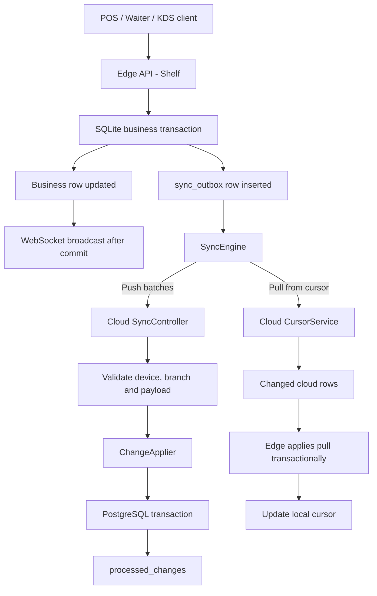

# M28 — Offline Data Synchronisation

**Project:** DineMaster  
**Module:** M28 — Offline Data Synchronisation  
**Scope:** EDGE, OPS, CORE, ID  
**Document type:** Module-level technical implementation specification  
**Status:** Draft — validate open decisions with the product owner before production

---

## 1. Purpose

M28 keeps the Edge node's SQLite database and the Cloud PostgreSQL database consistent while allowing a restaurant branch to continue its core operations when internet connectivity is unavailable.

The Edge node is the operational source of truth for its branch while offline. PostgreSQL is the system of record across tenants and branches. Client devices (waiter tablets, KDS screens and additional POS terminals) communicate with the single Edge host for branch operations; they are not independent sync authorities.

**Important:** SQLite and PostgreSQL do not synchronize automatically. M28 implements the outbox, push, pull, retry, conflict handling, epoch protection and monitoring required to keep the two stores consistent.

### 1.1 Goals

- Continue branch operations during an internet outage while the Edge node is running.
- Record every local mutation together with an outbox entry in one SQLite transaction.
- Push local changes to Cloud safely and idempotently.
- Pull remote changes using a cursor rather than downloading every record repeatedly.
- Preserve entity-specific conflict rules; do not apply a generic last-write-wins policy to every table.
- Prevent duplicate processing after retries, partial failures or network interruption.
- Detect restored old backups through sync epoch protection.
- Expose sync health and unresolved conflicts to authorized staff.

### 1.2 Non-goals

- Automatic merge of arbitrary offline edits.
- Running branch operations when the Edge host itself is down.
- Making a phone or tablet the Edge host.
- Allowing a branch to download other branches' orders.
- Replacing module-level business validation with sync-specific validation.

---

## 2. Architecture and components

### 2.1 Main components

| Component | Responsibility |
|---|---|
| `SyncEngine` (Edge) | Coordinates initial sync, push, pull, retries and recovery |
| `OutboxRepository` (Edge) | Reads and updates the local outbox in sequence |
| `ConflictResolver` (Edge) | Applies the agreed per-entity conflict rules and records unresolved conflicts |
| `SyncController` (Cloud) | Exposes sync endpoints |
| `ChangeApplier` (Cloud) | Validates and applies changes for each supported entity |
| `CursorService` (Cloud) | Issues and advances per-device, per-entity pull cursors |
| `ops.sync_cursors` (Cloud) | Stores cloud pull position per device and entity |
| `processed_changes` (Cloud) | Deduplicates already-applied change IDs |

### 2.2 High-level flow



### 2.3 Data ownership

- **Within one branch:** all clients write through one Edge host.
- **While offline:** Edge SQLite is authoritative for branch operations that are allowed offline.
- **Across branches:** Cloud merges branch data and distributes only the data each branch is permitted to receive.
- **Cloud-owned master data:** Cloud is authoritative for products, categories, prices, tax slabs, settings, users and roles.
- **Client cache:** a client-side cache is not authoritative and must not independently generate branch sync changes.

---

## 3. Offline capability boundaries

| Capability | Edge running, internet unavailable | Edge unavailable |
|---|---:|---:|
| Login with cached users | Yes | No |
| Orders, KOT and KDS | Yes | No |
| Billing, payments and printing | Yes | No |
| Reservations and table changes | Yes | No |
| Local stock deduction | Yes | No |
| Guest QR ordering on restaurant LAN | Yes | No |
| Menu or price edits | Only if allowed by policy; queued as proposals where applicable | No |
| Create tenant or branch | No | No |
| Cloud reports and cloud backup | No | No |

The UI must clearly distinguish **internet unavailable** from **Edge unavailable**. The offline banner means local branch operations can continue; it must not imply that the cloud has received the changes.

---

## 4. Local SQLite data model

Every synced business table must carry the common synchronization metadata:

| Column | Purpose |
|---|---|
| `id` | UUID primary identifier |
| `version` | Optimistic concurrency version |
| `updated_at` | Last update timestamp |
| `deleted_at` | Soft-delete timestamp for applicable master data |
| `sync_state` | `SYNCED`, `PENDING` or `CONFLICT` |

### 4.1 `sync_outbox`

The outbox is the durable queue of local changes waiting to be delivered to Cloud.

```sql
CREATE TABLE sync_outbox (
  seq          INTEGER PRIMARY KEY AUTOINCREMENT,
  id           TEXT NOT NULL UNIQUE,
  entity       TEXT NOT NULL,
  entity_id    TEXT NOT NULL,
  op           TEXT NOT NULL CHECK (op IN ('INSERT','UPDATE','DELETE')),
  payload      TEXT NOT NULL,
  base_version INTEGER,
  created_at   TEXT NOT NULL,
  attempts     INTEGER NOT NULL DEFAULT 0,
  next_try_at  TEXT,
  last_error   TEXT,
  status       TEXT NOT NULL DEFAULT 'PENDING'
               CHECK (status IN ('PENDING','SENT','FAILED','DEAD'))
);

CREATE INDEX ix_outbox_status
  ON sync_outbox (status, next_try_at);
```

Field notes:

- `seq` preserves local queue order.
- `id` is the unique `changeId` used for idempotency.
- `entity` identifies the business entity, for example `orders` or `payments`.
- `entity_id` identifies the changed business row.
- `op` is `INSERT`, `UPDATE` or `DELETE`.
- `payload` contains the validated change payload as JSON.
- `base_version` is the version on which the local edit was based.
- `attempts`, `next_try_at` and `last_error` support retry and troubleshooting.
- `DEAD` means the retry limit was reached and staff attention is required.

### 4.2 `sync_state`

```sql
CREATE TABLE sync_state (
  key   TEXT PRIMARY KEY,
  value TEXT NOT NULL
);
```

The source identifies these values:

- `pull_cursor`
- `last_success_at`
- `device_id`
- `schema_version`

The implementation also needs to persist the current sync epoch and initial-sync completion state. These are **[PROPOSED DETAIL]** keys; confirm the final key names during implementation.

### 4.3 `sync_conflicts`

```sql
CREATE TABLE sync_conflicts (
  id             TEXT PRIMARY KEY,
  entity         TEXT,
  entity_id      TEXT,
  local_payload  TEXT,
  server_payload TEXT,
  detected_at    TEXT,
  resolved_by    TEXT,
  resolution     TEXT
);
```

A conflict that cannot be resolved by the entity policy is stored here and shown in Sync Review.

### 4.4 Critical transaction rule

The business data change and its `sync_outbox` row must be written in **one SQLite transaction**.

Correct sequence:

1. Start SQLite transaction.
2. Validate the business operation.
3. Insert/update the business row.
4. Insert the matching outbox row.
5. Commit.
6. Broadcast the WebSocket event after commit.

If the transaction fails, neither the business change nor its outbox record may remain committed. Never create the business row first and enqueue it later in a separate transaction.

---

## 5. Cloud-side data model

The source names the following Cloud structures:

### 5.1 `ops.sync_cursors`

Stores the pull cursor for each device and entity.

**Required logical key:** `(device_id, entity)`.

**[PROPOSED DETAIL]** Suggested columns:

| Column | Type | Notes |
|---|---|---|
| `device_id` | UUID | Registered Edge device |
| `entity` | VARCHAR | Entity stream |
| `cursor` | BIGINT / TEXT | Opaque or monotonically increasing position |
| `updated_at` | TIMESTAMPTZ | Server timestamp |

Use a unique constraint on `(device_id, entity)`.

### 5.2 `processed_changes`

Stores processed change IDs so a retry cannot apply the same mutation twice.

**[PROPOSED DETAIL]** Suggested columns: `change_id` (primary key), `device_id`, `entity`, `entity_id`, `processed_at`, `result`, `server_version`.

The exact physical schema is not supplied in the master document; finalize it with the database design.

---

## 6. Synchronization lifecycle

### 6.1 Device activation and initial full sync

1. Register/authenticate the Edge device.
2. Validate the device's tenant and branch assignment.
3. Read the supported schema version and sync epoch.
4. Call `POST /api/v1/sync/full` to initiate the initial sync.
5. Download permitted baseline data in pages.
6. Apply each page in a local transaction.
7. Persist the cursor only after the page is committed.
8. Mark initial sync complete after all required entity streams finish.

**[PROPOSED DETAIL]** The full-sync response should provide a snapshot boundary/cursor so records created during the initial download are not missed. The source requires initial full sync but does not define the snapshot token or paging response contract.

### 6.2 Normal operation

- Local business writes create outbox entries.
- `SyncEngine` pushes pending changes in ascending `seq` order.
- The engine pulls Cloud changes using the saved cursor.
- The engine continues periodic/continuous push and pull while the network is available.
- The branch continues using SQLite when the internet is unavailable.

### 6.3 Network outage

- Do not discard or roll back valid local business operations.
- Keep unsent changes in `sync_outbox`.
- Display the offline indicator and pending count.
- Do not advance the pull cursor without successfully applying the corresponding page.

### 6.4 Network recovery

1. Detect connectivity using `connectivity_plus`.
2. Make a real health request to the gateway; Wi-Fi connectivity alone does not prove internet access.
3. Start the pusher immediately.
4. Push changes in `seq` order; changes for the same entity must remain ordered.
5. Pull remote changes using the last committed cursor.
6. Update status and last successful sync time.

---

## 7. Push API

### 7.1 Endpoint

`POST /api/v1/sync/push`

Device authentication is mandatory. The authenticated device must only be able to push changes for its own branch.

### 7.2 Request

```json
{
  "deviceId": "0191b0c2-aaaa-7000-8000-000000000001",
  "branchId": "0191a2b4-0002-7000-8000-bbbbbbbbbbbb",
  "schemaVersion": 3,
  "changes": [
    {
      "changeId": "0191b0c3-1111-7000-8000-000000000010",
      "entity": "orders",
      "entityId": "0191b0c3-2222-7000-8000-000000000020",
      "op": "UPDATE",
      "baseVersion": 2,
      "payload": {
        "status": "PAID",
        "total": 1180.00
      },
      "createdAt": "2026-11-03T12:55:10Z"
    }
  ]
}
```

### 7.3 Response

```json
{
  "results": [
    {
      "changeId": "0191b0c3-1111-7000-8000-000000000010",
      "result": "ACCEPTED",
      "serverVersion": 3
    }
  ],
  "serverTime": "2026-11-03T12:55:12Z"
}
```

Allowed result values:

| Result | Meaning | Edge action |
|---|---|---|
| `ACCEPTED` | Change was validated and applied | Mark outbox item sent; update local sync metadata |
| `DUPLICATE` | Change ID was already processed | Treat as success; do not apply again |
| `CONFLICT` | Entity policy/version check found a conflict | Store conflict and show in Sync Review |
| `REJECTED` | Payload or business rule was invalid | Keep local operation; record reason and route for review |

The source explicitly states that a rejected push does **not** undo the local operation; it goes to the needs-review queue.

### 7.4 Cloud push processing sequence

1. Authenticate the device.
2. Resolve its registered tenant and branch from server-side identity.
3. Verify request `deviceId` and `branchId` match the authenticated device.
4. Validate `schemaVersion`.
5. For each change, check `processed_changes` by `changeId`.
6. If already processed, return `DUPLICATE`.
7. Validate the payload using the same business rules as normal API writes.
8. Apply the entity-specific conflict policy.
9. Persist the business change and processed ID atomically.
10. Return one result per submitted change.

**[PROPOSED DETAIL]** A batch may contain both accepted and rejected changes. Return a result per `changeId`; do not assume the entire batch is all-or-nothing. This supports safe recovery from partial batch failure.

---

## 8. Pull API

### 8.1 Endpoint

`GET /api/v1/sync/pull?since=<cursor>&limit=500`

### 8.2 Purpose

Returns changed rows since the supplied cursor, such as:

- Menu and product changes
- Prices
- Users and settings
- Other permitted devices' data
- Other cloud-owned data required by that branch

A branch must not receive other branches' orders.

### 8.3 Pull processing rules

1. Edge sends its last committed cursor.
2. Cloud returns only data permitted for that device's branch.
3. Edge validates and applies the returned changes.
4. Edge commits the page.
5. Only after commit does Edge persist the new cursor.

**[PROPOSED DETAIL]** Use a stable ordering and opaque cursor or a monotonic server sequence. Do not use client wall-clock timestamps as the sole cursor because clock skew can cause missed or repeated rows.

---

## 9. Retry policy

The source-defined retry schedule is:

| Attempt | Delay |
|---:|---:|
| 1 | 5 seconds |
| 2 | 30 seconds |
| 3 | 2 minutes |
| 4 | 10 minutes |
| 5+ | 30 minutes |

- Maximum: 24 attempts.
- After 24 attempts: set status to `DEAD` and alert the Manager.
- On network recovery, the pusher starts immediately.
- Push in `seq` order.
- Changes for the same entity must be sent in order.

`connectivity_plus` is used as a connectivity signal, followed by a real health call to the gateway. A connected Wi-Fi network does not necessarily mean the Cloud is reachable.

**[PROPOSED DETAIL]** Add bounded request timeouts and jitter to retry delays to avoid synchronized retry spikes across many branches. Keep the source-defined retry intervals as the baseline unless the product owner approves a change.

---

## 10. Conflict resolution rules

Do not use one global last-write-wins strategy. Apply the source-defined rule for each entity.

| Entity | Conflict rule | Implementation meaning |
|---|---|---|
| `orders`, `order_items`, `payments`, `kots`, status logs | Append-only events; Edge is authority for its branch | Cloud must not overwrite branch events with older data |
| Invoices | Edge assigns number using per-branch counter; Cloud rejects duplicates | Preserve legal invoice numbering |
| Products, categories, prices, tax slabs, settings | Cloud wins | Edge edits, if allowed, are proposals |
| Users, roles | Cloud wins | Security and access control remain centrally managed |
| Stock | Signed deltas in `stock_movements` | Compute balance from movements; never overwrite a stock balance |
| Table status | Edge wins | Live branch state |
| Table layout | Cloud wins | Configuration state |
| Reservations | Last write by `updated_at`; clashes with another booking go to review | Do not silently accept overlapping bookings |
| Customer fields | Newer `updated_at` | Resolve ordinary profile field changes |
| Loyalty | Ledger rows are append-only | Preserve earn/redeem transactions |

Anything the rules cannot resolve is stored in `sync_conflicts` and shown to the Manager in **Sync Review**.

### 10.1 Conflict review

The screen should show:

- Entity and record identifier
- Local payload
- Server payload
- Conflict detection time
- Reason / conflict category
- Resolution status

The module exposes `POST /api/v1/sync/conflicts/{id}/resolve`.

**[PROPOSED DETAIL]** Resolution choices must be constrained by entity policy. A Manager must not be allowed to override Cloud-owned users/roles or rewrite append-only financial history. Record who resolved the conflict and the chosen resolution.

---

## 11. Duplicate prevention, versions and epoch protection

### 11.1 Change ID idempotency

- Every change has a unique `changeId`.
- Cloud stores processed IDs.
- Repeated delivery of the same ID returns `DUPLICATE`.
- `DUPLICATE` is treated as success by the Edge; the mutation must not be applied twice.

### 11.2 Row versioning

- Every synced row has a `version`.
- A Cloud update with `baseVersion` lower than the current server version is a conflict, except where the entity is append-only and its policy says otherwise.
- Increment the row version when an accepted update is applied.

### 11.3 Epoch protection

A restored old Edge backup must not be allowed to push stale changes as if it were the current device state. Cloud must reject a device presenting a lower sync epoch.

**[PROPOSED DETAIL]** Maintain a server-issued epoch for each registered Edge installation. When an authorized restore/reinitialization occurs, rotate the epoch and require the Edge to re-bootstrap. The precise restore authorization and recovery workflow needs product-owner approval.

### 11.4 Order numbering

Format: `<branchCode>-<yyyymmdd>-<seq>`

- `seq` comes from the host Edge only.
- Two Edge hosts for one branch are not supported by the source design.
- Adding a device code to prevent collisions is an **[ASSUMPTION]**, not an existing requirement.

---

## 12. Multi-device and multi-branch rules

- All devices in one branch write through one Edge host.
- The Edge host is the single operational authority for that branch.
- Cloud merges data across branches.
- Each branch pulls only permitted data such as its menu, users and settings; it does not pull other branches' orders.
- The Edge host stamps official server time. Client devices must not decide the official timestamp.
- Edge host failure is a separate availability issue; M28 does not provide automatic Edge failover.

---

## 13. Sync monitoring and UI

### 13.1 Screens

1. **Sync Status** — available to Manager and Admin.
2. **Sync Review** — displays unresolved conflicts and rejected changes.
3. **Force Sync** — Admin-only action.

### 13.2 Sync Status fields

- Online / offline
- Pending count
- Failed count
- Last successful sync
- Oldest pending item age
- Current device and branch
- Schema version / compatibility state
- Conflict count

### 13.3 Alerts

- Pending age exceeds 30 minutes while online.
- Any outbox item reaches `DEAD`.
- Schema version mismatch.
- Conflict requires review.

### 13.4 Cloud metrics

- `sync_pending_count`
- `sync_lag_seconds`
- `sync_conflict_count`

### 13.5 Events

- `SyncStarted`
- `SyncCompleted`
- `SyncFailed`
- `ConflictResolved`

**[PROPOSED DETAIL]** Include `deviceId`, `branchId`, timestamp, result counts and request/correlation ID in operational logs. Do not include credentials, password hashes or sensitive payment data in logs.

---

## 14. API list

| Method | Endpoint | Purpose |
|---|---|---|
| `POST` | `/api/v1/sync/push` | Push local outbox changes |
| `GET` | `/api/v1/sync/pull?since=<cursor>&limit=500` | Pull remote changes |
| `GET` | `/api/v1/sync/status` | Read sync health and queue counts |
| `POST` | `/api/v1/sync/conflicts/{id}/resolve` | Resolve a conflict |
| `POST` | `/api/v1/sync/full` | Initiate initial full sync |

All endpoints require device authentication and branch-scoped authorization. The push endpoint must validate payloads with the same rules as normal API writes.

---

## 15. Security requirements

- Authenticate the Edge device independently from staff user authentication.
- Bind each device identity to one tenant and branch.
- Never trust `deviceId`, `branchId` or tenant values supplied only in the request body.
- Reject a device attempting to push for another branch.
- Validate every entity payload using the same domain validation as ordinary API writes.
- Apply tenant isolation to every read and write.
- Do not send one branch's orders to another branch.
- Protect Cloud traffic with TLS.
- Do not log access tokens, secrets or sensitive payment data.
- Restrict Force Sync and conflict resolution to authorized roles.
- Audit conflict resolution and administrative sync actions.

---

## 16. Failure scenarios and expected behaviour

| Scenario | Expected behaviour |
|---|---|
| Same push request is sent twice | Second delivery returns `DUPLICATE`; no second mutation |
| Network dies during push | Unconfirmed items remain eligible for retry; server-processed IDs prevent duplicate application |
| Only part of a batch succeeds | Process per-change results; retry only unresolved items |
| Edge process stops mid-transaction | SQLite transaction rolls back; no orphaned business/outbox state |
| Edge stops after Cloud accepted a change but before local acknowledgement | Retry is safe because Cloud recognizes `changeId` |
| Schema version mismatch | Stop incompatible application, show status/alert; do not silently discard changes |
| Old backup is restored | Lower sync epoch is rejected; require controlled recovery |
| Clock skew on client | Use Edge host/server time for official timestamps |
| 10,000-change backlog | Continue ordered batches, expose lag and pending count; do not skip records |
| Invalid business payload | Return `REJECTED` with reason; retain local operation for review |
| Conflict cannot be automatically resolved | Persist in `sync_conflicts` and show Sync Review |

---

## 17. Testing strategy

### 17.1 Unit tests

- Outbox row is created for every supported local mutation.
- Business mutation and outbox insert commit or roll back together.
- Outbox ordering by `seq`.
- Retry schedule and max-attempt transition to `DEAD`.
- `changeId` duplicate detection.
- Per-entity conflict policy.
- Version mismatch handling.
- Cursor persistence only after successful local application.

### 17.2 Integration tests

- Push a valid order change and verify Cloud persistence.
- Push the same `changeId` twice and verify one mutation.
- Pull menu/settings changes and verify Edge state.
- Verify a branch cannot pull another branch's orders.
- Verify a device cannot push for another branch.
- Verify a rejected push remains locally available for review.
- Verify conflict resolution records the actor and resolution.
- Verify initial sync paging does not miss changes created during the sync.

### 17.3 Required chaos tests

The master document explicitly calls for:

1. Kill the network in the middle of a push.
2. Kill the Edge process in the middle of a transaction.

Also test:

- Restore an older SQLite backup.
- Introduce clock skew.
- Create a 10,000-change backlog.
- Restart the app during retry.
- Simulate partial batch acceptance.
- Change the schema version between Edge and Cloud.
- Run two clients against the same Edge host while syncing is active.

### 17.4 Acceptance criteria

- No committed local business change exists without its outbox record.
- A repeated `changeId` never creates a duplicate Cloud mutation.
- A failed network call never causes a valid local operation to disappear.
- Pull cursor never advances before the corresponding page is committed locally.
- Per-entity conflict rules are followed.
- A branch cannot access another branch's operational data.
- An old sync epoch is rejected.
- A `DEAD` item and schema mismatch are visible to authorized staff.
- The two required chaos tests pass reliably.

---

## 18. Implementation sequence

Follow the source-defined order:

| Step | Work | Deliverable |
|---:|---|---|
| 1 | Outbox first | SQLite metadata, `sync_outbox`, transactional write integration |
| 2 | Push endpoint | Device auth, payload validation, `processed_changes`, per-change result |
| 3 | Pull endpoint | Cursor service, scoped change feed, transactional Edge apply |
| 4 | Conflicts UI | Conflict storage, resolution endpoint, Sync Review screen |

Recommended detailed tasks:

### Phase A — Foundations
- Add UUID/version/sync metadata to all in-scope synced tables.
- Create `sync_outbox`, `sync_state`, `sync_conflicts`.
- Introduce a shared outbox writer used by module repositories.
- Add tests proving atomic business-write plus outbox-write behaviour.

### Phase B — Cloud push
- Register Edge device identity and branch binding.
- Implement `SyncController` and `ChangeApplier`.
- Add processed-change idempotency.
- Implement entity policy checks and per-change responses.

### Phase C — Pull and initial sync
- Implement `CursorService` and `ops.sync_cursors`.
- Add branch-scoped pull queries.
- Implement paged initial full sync.
- Apply pull pages transactionally on Edge.

### Phase D — Recovery and conflict operations
- Implement retry scheduler and connectivity health check.
- Implement conflict persistence and resolution endpoint.
- Build Sync Status, Sync Review and Admin Force Sync.
- Add alerts and metrics.

### Phase E — Hardening
- Run chaos and migration tests.
- Test backup restore and epoch rejection.
- Test large backlog and schema mismatch.
- Complete security and branch-isolation tests.

---

## 19. Dependencies and impact

M28 touches every module that writes synced data. At minimum, integration is required with:

- Authentication and device identity
- Restaurant and Branch Management
- User and Staff Management
- Menu, Category and Product
- POS and Cart
- Orders, KOT and KDS
- Tables, Floors and Reservations
- Payments and Invoices
- Recipe, Inventory and Stock Movements
- Customers, Loyalty, Offers
- Settings, Notifications and Audit

Every module must use the shared write/outbox mechanism for its sync-enabled mutations. Avoid implementing a separate custom sync queue in each module.

---

## 20. Open decisions and items to confirm

The source defines the high-level sync protocol and conflict rules, but does not fully specify the following implementation details:

1. Exact device registration and credential rotation workflow.
2. Exact Cloud DDL for `ops.sync_cursors` and `processed_changes`.
3. Full-sync snapshot token and pagination contract.
4. Exact supported `schemaVersion` compatibility policy.
5. Exact sync epoch issuance, backup restore authorization and re-bootstrap workflow.
6. Which Manager actions are permitted for each conflict type.
7. Whether any Edge-originated master-data edit is allowed as a proposal and how approval is performed.
8. Exact push batch size and pull page size beyond the documented pull example `limit=500`.
9. Retention policy for processed change IDs and resolved conflicts.
10. Whether force sync means immediate retry, full re-pull, or a controlled re-bootstrap.

Do not silently decide these in production. Record owner approval and update this document before implementation is considered complete.

---

## 21. Definition of Done

- [ ] All synced tables have stable UUIDs and version metadata.
- [ ] Local business writes and outbox inserts are atomic.
- [ ] Push endpoint validates device, branch, schema and business payload.
- [ ] Duplicate change IDs return `DUPLICATE`.
- [ ] Pull uses a cursor and commits data before cursor advancement.
- [ ] Retry policy is implemented, including `DEAD` after 24 attempts.
- [ ] Per-entity conflict rules are implemented.
- [ ] Sync epoch protection blocks stale restored backups.
- [ ] Sync Status and Sync Review screens are available to authorized users.
- [ ] Force Sync is Admin-only.
- [ ] Branch isolation and device authentication tests pass.
- [ ] Required chaos tests pass.
- [ ] Metrics and alerts are operational.

---

## 22. Source alignment

This document is based on the DineMaster master technical documentation:

- Chapter 8: Offline-First Architecture and Synchronisation (Sections 8.1–8.10).
- Chapter 9: M28 Offline Data Synchronisation (EDGE, OPS, CORE, ID).
- Chapter 10: API conventions and common error response.

Source-defined items are retained as requirements. Additional implementation suggestions are marked **[PROPOSED DETAIL]**. Items that the source does not settle are listed in **Open decisions** rather than treated as confirmed requirements.
